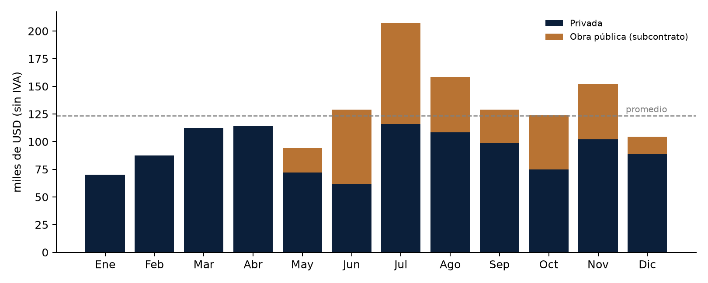
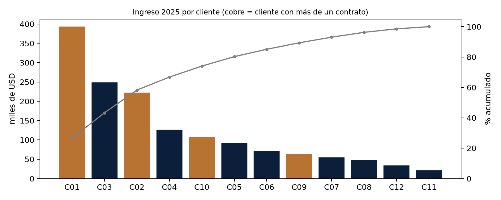
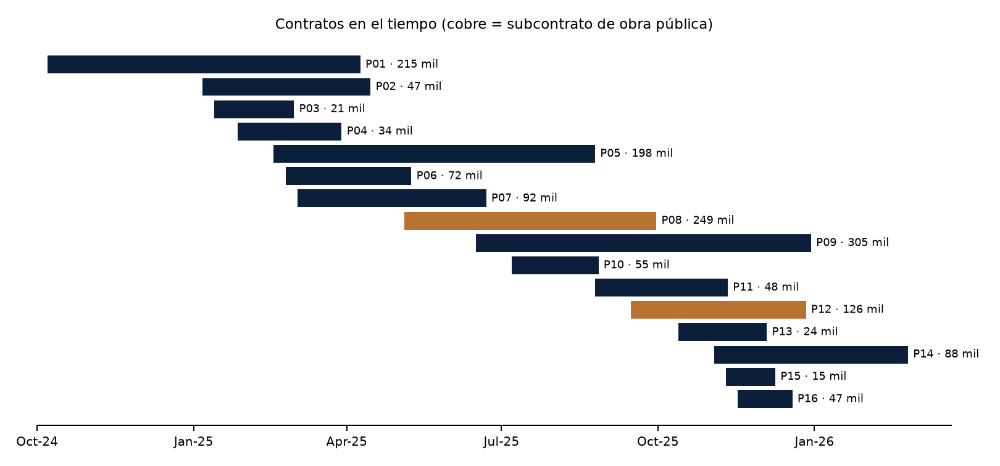

# Ingresos 2025 de Torvesa: análisis provisional

> ⚠ **Provisional.** El archivo se describe a sí mismo con tres frases:
> - «Clientes ficticios» (hoja «Ingresos por cliente», celdas A2 y B4).
> - «contratos … (ficticios)» (hoja «Proyectos», celda A1).
> - «Resultado del modelo de avance de obra» (hoja «Ingresos por proyecto», celda A2).
>
> Diego pide a Torvesa, por correo, que confirme que los **montos** son reales y que solo cambiaron los nombres. Hasta esa confirmación nada de este análisis entra en los capítulos, en el VAN/TIR ni en la matriz.

## 1. Resumen en 6 puntos
1. **Tamaño del año:** USD 1.482.812 sin IVA reconocidos en 2025.
   - Promedio de USD 123.568 por mes.
   - 16 contratos con 12 clientes: 15 firmados en 2025 y 1 que venía de 2024.
2. **Todo es obra vial:** vías internas, adoquinado, asfalto, pavimento rígido, lastrado y cunetas. Esto coincide con el giro que dice el diseño aprobado («construcción de vías»).
3. **El cliente que vuelve pesa mucho:** 4 de los 12 clientes (C01, C02, C09 y C10) contrataron dos veces y suman el **53 %** del ingreso. Es el dato más útil para la tesis: respalda la importancia del **historial del cliente** (amnesia institucional, A8).
4. **Dependencia de pocos clientes:**
   - el cliente principal es el 26,5 %;
   - los tres principales suman el 58,3 %;
   - el índice Herfindahl-Hirschman (HHI) es de 1.446, en una escala de 0 a 10.000. Si se quiere calificar ese valor en la tesis, el umbral se cita con fuente: [FALTA-FUENTE].
5. **Estacionalidad:**
   - el tercer trimestre concentra el 33 % del año (julio es el pico, con USD 207.047);
   - enero es el mes más bajo (USD 70.164);
   - el segundo semestre es el 59 % del año;
   - la variación entre meses es del 28 %.
6. **Mezcla de demanda:**
   - el 75 % es privada: inmobiliarias, fideicomisos, industrias, colegios, personas;
   - el 25 % son **subcontratos de obra pública**, de dos contratistas de GAD, entre mayo y diciembre.

## 2. Ingresos por mes

| Mes | Total (USD) | Obra pública | Privada |
|---|---|---|---|
| Ene | 70.164 | 0 | 70.164 |
| Feb | 87.684 | 0 | 87.684 |
| Mar | 112.349 | 0 | 112.349 |
| Abr | 114.148 | 0 | 114.148 |
| May | 94.365 | 22.374 | 71.991 |
| Jun | 129.034 | 67.158 | 61.876 |
| Jul | 207.047 | 90.961 | 116.086 |
| Ago | 158.697 | 50.200 | 108.497 |
| Sep | 128.820 | 29.821 | 98.998 |
| Oct | 123.673 | 48.744 | 74.929 |
| Nov | 152.367 | 50.408 | 101.959 |
| Dic | 104.464 | 15.259 | 89.206 |
| **Total** | **1.482.812** | **374.925 (25 %)** | **1.107.886 (75 %)** |

Por trimestre:

| Trimestre | Ingreso (USD) | % del año |
|---|---|---|
| T1 | 270.197 | 18 % |
| T2 | 337.547 | 23 % |
| T3 | 494.564 | 33 % |
| T4 | 380.504 | 26 % |

## 3. Clientes

| Cliente | Segmento | Contratos | Ingreso 2025 (USD) | % |
|---|---|---|---|---|
| C01 | Promotor inmobiliario | 2 | 393.188 | 26,5 |
| C03 | Contratista principal de obra pública | 1 | 248.631 | 16,8 |
| C02 | Fideicomiso inmobiliario | 2 | 222.172 | 15,0 |
| C04 | Contratista principal de obra pública | 1 | 126.294 | 8,5 |
| C10 | Constructora (subcontrato privado) | 2 | 107.632 | 7,3 |
| C05 | Empresa industrial | 1 | 92.419 | 6,2 |
| C06 | Empresa comercial y logística | 1 | 71.836 | 4,8 |
| C09 | Empresa agroexportadora | 2 | 63.141 | 4,3 |
| C07 | Institución educativa privada | 1 | 54.877 | 3,7 |
| C08 | Conjunto habitacional | 1 | 47.318 | 3,2 |
| C12 | Persona natural | 1 | 33.919 | 2,3 |
| C11 | Persona natural | 1 | 21.385 | 1,4 |

Los nombres de los clientes no se copian aquí: el archivo dice que son ficticios.

## 4. Contratos: lo que importa para la gestión comercial

| Indicador | Valor |
|---|---|
| Contratos firmados en 2025 | 15, es decir, unos 1,25 por mes |
| Meses con más firmas | enero y noviembre (3 cada uno); en abril y diciembre no se firmó ninguno |
| Monto por contrato | promedio USD 102.288; mediana USD 63.357; de USD 14.928 a USD 304.713 |
| Plazo contractual | mediana de 85 días (de 30 a 190) |
| Modalidad | 11 a precio unitario, con planillas mensuales o quincenales; 5 a suma alzada, con pagos por hitos |
| Anticipo | promedio 21,6 % (de 0 a 40 %); según la nota del archivo, el anticipo es un pasivo y no un ingreso |
| Cobro | planillas a 30–45 días; en los subcontratos de obra pública, 30 días **después** de que el GAD pague al contratista principal |
| Paralizaciones | 6 contratos con prórroga, 45 días en total (apagones, paro, lluvias de octubre) |
| Saldo que pasa a 2026 | USD 27.634 (P14) |

**Para el VAN y la TIR (D7):** el beneficio del sistema se puede expresar como «contratos adicionales ganados» o «cotizaciones atendidas a tiempo». Con estos datos, un contrato típico vale entre USD 63.000 (mediana) y USD 102.000 (promedio) en ventas. **Faltan dos datos de Torvesa para cerrar el cálculo:**
1. **Cuántas cotizaciones se emitieron en 2025**, para sacar la tasa de cierre: 15 contratos ÷ N cotizaciones.
2. **El margen bruto o utilidad por contrato**. El VAN se calcula sobre la utilidad, no sobre la venta.

## 5. Controles hechos al archivo
| Control | Resultado |
|---|---|
| Suma por proyectos = suma por clientes = resumen mensual | ✓ cuadra al centavo |
| Monto = ejecutado 2024 + ingreso 2025 + saldo 2026, en los 16 contratos | ✓ |
| IVA 15 %, anticipo = % × monto, plazo = fechas | ✓ |
| Ingresos solo dentro del plazo de cada contrato | ✓ |
| Subcontratos de obra pública ≤ 30 % del contrato principal (LOSNCP art. 79) | ✓ P08 18,2 %; P12 19,7 % |

El archivo es **internamente coherente**: no tiene errores de suma ni fechas imposibles.

## 6. Lo que hay que aclarar con Torvesa (además de la confirmación)
1. **La serie mensual parece calculada, no tomada de la contabilidad.**
   - La hoja «Resumen mensual» trae un «índice de intensidad usado», armado con despachos de cemento, ventas del SRI y un factor de lluvia. El ingreso de cada mes se parece a ese índice (correlación 0,69).
   - Unos datos contables no traen esos índices: son señal de que la IA **repartió** montos con un modelo.
   - **Pregunta:** ¿el total por contrato es real y lo que se calculó es solo su reparto por meses? Si es así, para la tesis basta el total por contrato, que es lo que afecta al VAN.
2. **El dato de diciembre del SRI se reemplazó.** Las ventas del SRI de diciembre (400,9 millones) se cambiaron por el promedio de octubre y noviembre (199,3). Es razonable, pero es un ajuste del modelo, no un dato.
3. **No coincide con el diseño aprobado:**
   - El archivo dice **33 trabajadores**; el diseño aprobado dice **30 colaboradores**.
   - El diseño habla de **33 clientes**; aquí hay **12 clientes con ingreso en 2025**. Pueden ser universos distintos (clientes históricos frente a clientes del año), pero hay que confirmarlo. Afecta a A2, A3 y a la población.
4. **Ingreso por trabajador:** USD 44.934, frente a una «mediana Pichincha 2025» de USD 42.811 para empresas de 25 a 40 empleados (CIIU F41–F43) que trae el archivo. **No se sabe de dónde sale esa mediana**: no se usa sin fuente.
5. **Cruce externo pendiente.** Los estados financieros de 2025 que Torvesa presentó a la Superintendencia de Compañías permiten comprobar el total anual. El portal pide captcha, así que **lo consulta Víctor o Diego a mano** con el RUC del diseño aprobado.

## 7. Qué sirve para la tesis, si se confirma
| Uso | Dato | Dónde |
|---|---|---|
| Contexto de la empresa (A1–A3) | ingreso anual, n.º de contratos, giro vial, mezcla privada/pública | Cap. I, 1.2 |
| Justificar el historial del cliente (A8) | 53 % del ingreso viene de clientes que repiten | Cap. I, 1.3 y Cap. II |
| Valorar una respuesta rápida | 1,25 contratos por mes; monto típico de USD 63.000–102.000 | Cap. I (justificación) y VAN/TIR |
| Escenarios del VAN/TIR | ingreso base, estacionalidad y plazos de cobro | Cap. IV (modelo de negocio) |
| Limitación | dependencia de pocos clientes y del ciclo de obra pública | Cap. I, alcance |

Se citaría como: Torvesa Constructora. (2026). *Ingresos reconocidos por contrato, enero–diciembre 2025* [Información interna proporcionada a los autores].

## 8. Siguiente paso
- [ ] Diego: correo a Torvesa para confirmar que los montos son reales y que solo cambiaron los nombres; aprovechar para pedir el n.º de cotizaciones de 2025, el margen bruto y aclarar 33 frente a 30 trabajadores.
- [ ] Víctor o Diego: consulta de los estados financieros de 2025 en la Superintendencia de Compañías.
- [ ] Claude, al llegar la confirmación: quitar la marca de provisional, pasar los datos a la matriz (A1–A3, A8) y al modelo del VAN/TIR.
