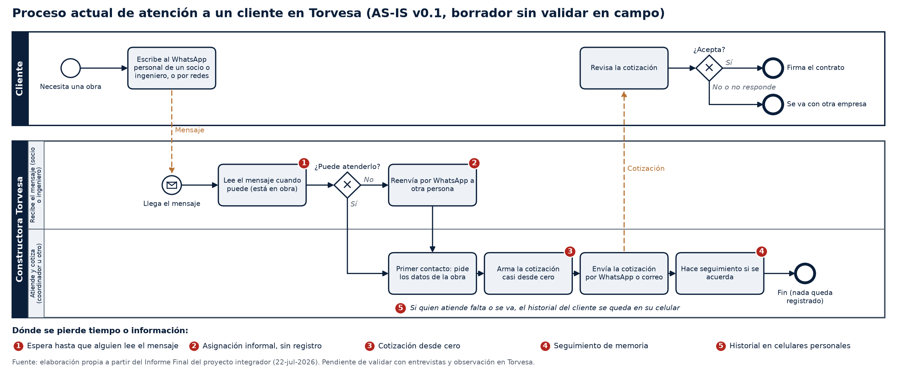
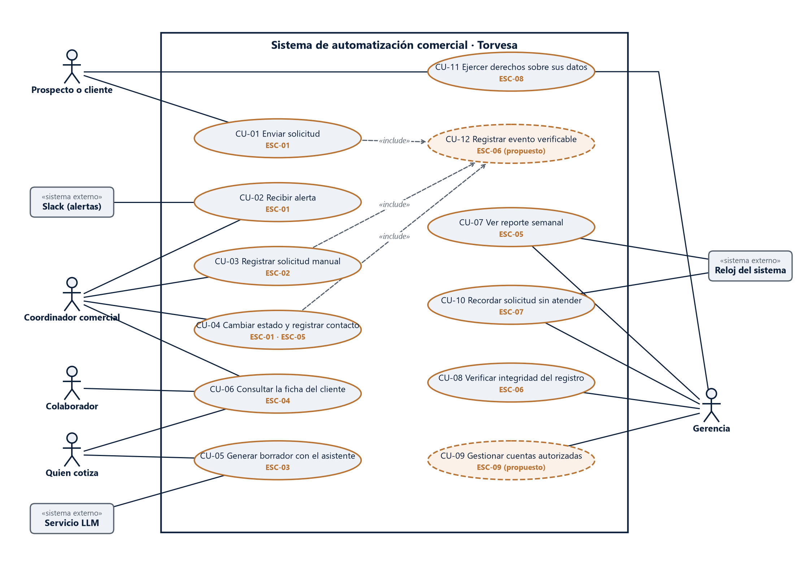
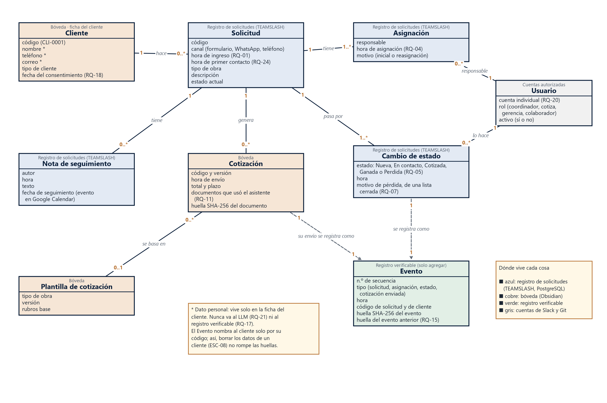
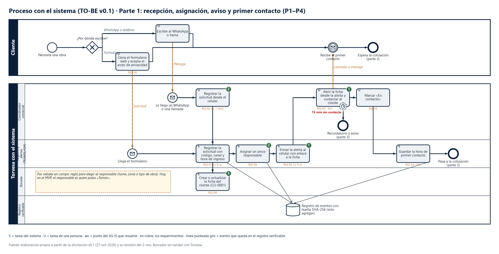
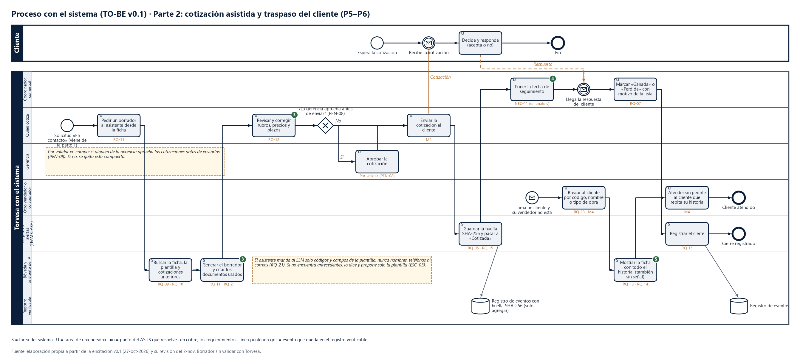
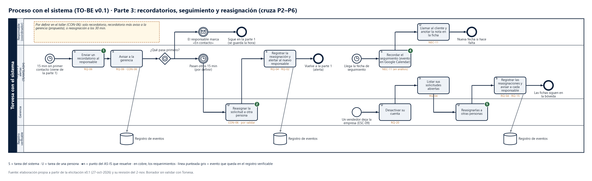
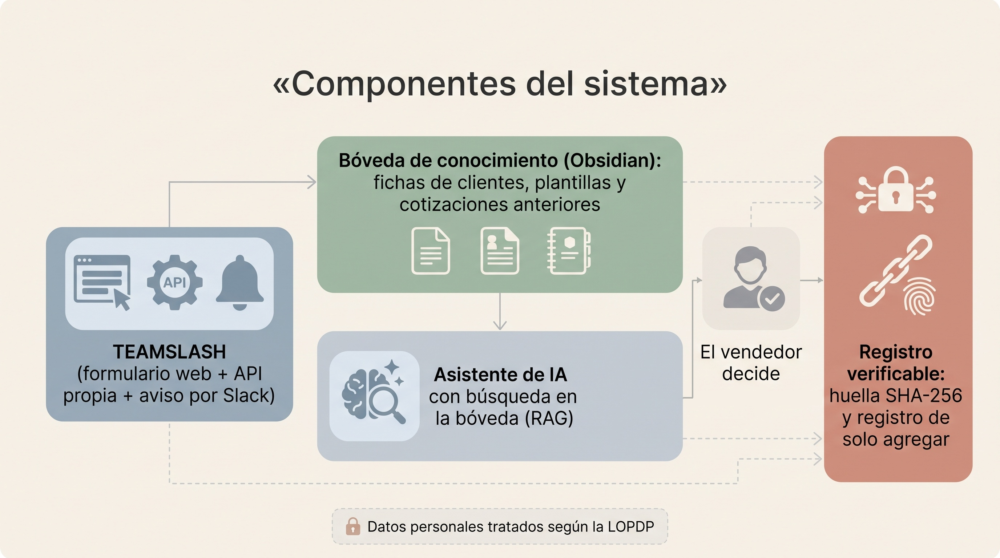

# CAPÍTULO IV

# DESARROLLO TÉCNICO

Este capítulo reúne las dos primeras actividades de la investigación en ciencia del diseño aplicadas al caso: la identificación del problema con evidencia de la empresa (diagnóstico) y el diseño del artefacto. En DSR, la descripción del artefacto ocupa el lugar de los resultados de un trabajo empírico, por lo que aquí se presentan los requisitos, los procesos con el sistema, sus componentes y las decisiones de diseño con su justificación. [DECIDIR-TUTORA: el manual de estilo une el diagnóstico y el diseño en un solo capítulo, «Desarrollo técnico»; se consulta si el diagnóstico puede ser un capítulo propio]

## Diagnóstico del proceso actual

### Cómo se levantó el proceso actual

El proceso actual (AS-IS) se modeló con la notación BPMN 2.0, pensada para que la entiendan tanto las personas del negocio como las técnicas (Object Management Group, 2013, p. 1), con un carril por cada rol, que es la forma en que los empleados de una empresa mediana mejor reconocen quién hace cada paso (Nizioł et al., 2021, p. 199). Se siguió el orden que usan estudios recientes en organizaciones ecuatorianas y latinoamericanas: primero se arma un borrador con los documentos disponibles y después se contrasta con la evidencia de la empresa (Zambrano Loor y García Vera, 2025, p. 79; Martínez Mendoza et al., 2023, p. 4836). En esta versión, la fuente es el informe final del proyecto integrador TEAMSLASH (Bermeo y Segura, 2026). Por eso el modelo es preliminar: dos de sus pasos son supuestos y todos se contrastarán con la muestra de solicitudes de la empresa [FALTA-DATO: autorización de Torvesa para revisar las solicitudes de los últimos tres meses].

### El proceso actual de atención a un cliente

La Figura 1 muestra el proceso actual en ocho pasos. El cliente escribe al WhatsApp personal de un socio o de un ingeniero, o por redes sociales (Bermeo y Segura, 2026, p. 4). Quien recibe el mensaje suele estar en obra y lo lee cuando puede; si no puede atenderlo, lo delega por canales informales (Bermeo y Segura, 2026, p. 7). Quien atiende hace el primer contacto, arma la cotización casi desde cero, la envía y hace el seguimiento si lo recuerda. Al final, el cliente acepta o se va con otra empresa, sin que quede registrado el motivo (Bermeo y Segura, 2026, p. 4).

*Nota.* Elaboración propia con base en el informe final del proyecto integrador (Bermeo y Segura, 2026). El reenvío por WhatsApp (paso 3) y la forma de envío de la cotización (paso 6) son supuestos por confirmar.

[DECIDIR-VÍCTOR: el informe final trae un censo de cinco personas (p. 10) sobre el canal de ingreso y la frecuencia con la que se revisan los mensajes. Si ese censo fue real, sus cifras pueden ir aquí como antecedente; si fue parte del diagnóstico simulado, no se usan]

### Puntos donde se pierde tiempo o información

El análisis del proceso identifica cinco puntos críticos (Tabla 1). Cada uno se relaciona con una meta de validación y con una función que el sistema debe cumplir; de esa relación salen los requisitos de la sección siguiente.

**Tabla 1.** *Puntos críticos del proceso actual y función que el sistema debe cumplir*

| Punto crítico | Qué pasa hoy | Función del sistema | Meta |
|---|---|---|---|
| 1. Espera | Nadie ve el mensaje hasta que revisa el celular | Registrar la solicitud y avisar al instante al celular del responsable | M1, M3 |
| 2. Asignación informal | La delegación no deja rastro ni un responsable claro | Asignar un único responsable, registrar cada cambio de estado y recordar a los 15 minutos | M1, M3 |
| 3. Cotización desde cero | Las cotizaciones anteriores están dispersas en celulares y cuadernos | Plantillas por tipo de obra y borrador propuesto por el asistente, revisado por una persona | M2 |
| 4. Seguimiento de memoria | Sin recordatorios, el interés del cliente se enfría | Fecha de seguimiento con recordatorio | — |
| 5. Historial en los celulares | Si un vendedor se va, se pierde lo que sabía del cliente | Ficha por cliente en la bóveda, que cualquier persona autorizada puede consultar | M4 |

*Nota.* Elaboración propia. Además, en todos los pasos el sistema debe dejar un registro verificable de cada evento (M5) y proteger los datos personales (LOPDP).

### Línea base

La línea base de las metas M1 a M5 se calcula con documentos de la empresa (fechas y horas de las solicitudes de los últimos tres meses, sin datos de clientes) y con los casos de prueba del equipo [FALTA-DATO: línea base M1 y M3, muestra documental de Torvesa] [FALTA-DATO: línea base M2 y M4, casos de prueba del sprint 5]. [DECIDIR-TUTORA: la forma de medir depende de la propuesta de no recoger datos de personas (véase el capítulo III)]

## Diseño del sistema

### Requisitos

Los requisitos se obtuvieron con un proceso de elicitación y análisis basado en la norma ISO/IEC/IEEE 29148 y en la guía SWEBOK [FALTA-DATO: ficha de la norma ISO/IEC/IEEE 29148 y de SWEBOK en la base de fuentes]. La primera iteración partió de los documentos del proyecto integrador y del código de TEAMSLASH, revisado el 2 de noviembre de 2026. Cada requisito tiene un identificador, la necesidad de la que sale, un criterio de aceptación y la forma de verificarlo. La Tabla 2 resume los 24 requisitos; la versión completa, con su trazabilidad, va en el Anexo 2.

**Tabla 2.** *Requisitos del sistema*

| Código | Requisito (resumen) | Tipo | Meta |
|---|---|---|---|
| RQ-01 | Registrar cada solicitud del formulario con fecha y hora de ingreso en 5 segundos o menos | Funcional | M1 |
| RQ-02 | Enviar una alerta al celular del responsable en 5 segundos o menos, con enlace a la ficha del cliente | Funcional | M1 |
| RQ-03 | Registrar desde el celular una solicitud recibida por WhatsApp o por teléfono, con la hora real de llegada | Funcional | M1, M3 |
| RQ-04 | Asignar cada solicitud a un único responsable y registrar la asignación | Funcional | M1 |
| RQ-05 | Registrar el estado de cada solicitud: Nueva, En contacto, Cotizada, Ganada o Perdida | Funcional | M1, M3 |
| RQ-06 | A los 15 minutos sin primer contacto, recordar al responsable y avisar a la gerencia | Funcional | M1, M3 |
| RQ-07 | Exigir un motivo de una lista cerrada al marcar una solicitud como Perdida | Funcional | M3 |
| RQ-08 | Generar cada lunes un reporte con la mediana del tiempo de primer contacto, los estados y los motivos de pérdida | Funcional | M1, M3 |
| RQ-09 | Mantener en la bóveda una ficha por cliente, con código, y su historial de solicitudes y cotizaciones | Funcional | M4 |
| RQ-10 | Mantener en la bóveda plantillas de cotización por tipo de obra | Funcional | M2 |
| RQ-11 | Generar con el asistente un borrador de respuesta o de cotización e indicar qué documentos usó | Funcional | M2 |
| RQ-12 | Exigir la revisión y la aprobación de una persona antes de enviar cualquier borrador al cliente | No funcional | M2 |
| RQ-13 | Buscar un cliente por código, nombre o tipo de obra y mostrar su historial completo | Funcional | M4 |
| RQ-14 | Mostrar sin conexión las fichas ya sincronizadas en el celular | No funcional | M4 |
| RQ-15 | Guardar cada evento en un registro de solo agregar, con su huella SHA-256 y la del evento anterior | Funcional | M5 |
| RQ-16 | Verificar la integridad del registro y señalar cada evento alterado | Funcional | M5 |
| RQ-17 | Guardar en el registro verificable solo huellas y códigos, sin datos personales | Normativo | — |
| RQ-18 | Pedir en el formulario el consentimiento del prospecto, con enlace al aviso de privacidad | Normativo | — |
| RQ-19 | Eliminar o anonimizar los datos de los prospectos perdidos al cumplirse el plazo de conservación | Normativo | — |
| RQ-20 | Dar acceso solo a cuentas individuales autorizadas por la gerencia | No funcional | — |
| RQ-21 | Enviar al servicio de IA solo códigos de cliente, nunca nombres, teléfonos ni correos | Normativo | — |
| RQ-22 | Alcanzar una usabilidad aceptable al final de la validación | No funcional | M6 |
| RQ-23 | Validar el diseño en operación experimental controlada durante dos semanas | De proyecto | — |
| RQ-24 | Guardar la hora del primer contacto de cada solicitud | Funcional | M1 |

*Nota.* Elaboración propia a partir del documento de elicitación y análisis de requerimientos, versión 0.1 (27 de octubre de 2026), con la revisión técnica del 2 de noviembre de 2026. RQ-22 cambia si se acepta la propuesta de medir la usabilidad sin cuestionarios (capítulo III).

La priorización combinó el valor para el negocio, la urgencia, el costo y el riesgo de cada requisito. Quedaron con prioridad alta el registro de la solicitud, la alerta, el registro manual de lo que llega por WhatsApp, el responsable único, los estados, la revisión humana de los borradores y los tres requisitos de protección de datos (RQ-17, RQ-18 y RQ-21). El borrador con IA (RQ-11) y el registro de solo agregar (RQ-15) quedaron con prioridad baja por su costo y su riesgo técnico, aunque son parte del aporte del proyecto; por eso se acotan: el asistente solo propone borradores que una persona revisa (RQ-12).

### Casos de uso y modelo conceptual

La Figura 2 muestra los 12 casos de uso del sistema y sus actores: el prospecto o cliente, el coordinador comercial, quien cotiza, los colaboradores, la gerencia y tres sistemas externos (el canal de alertas, el servicio de IA y el reloj del sistema). Cada caso de uso tiene un escenario operacional y está ligado a sus requisitos.

*Nota.* Elaboración propia. CU-12 (registrar evento verificable) se incluye en todos los casos que cambian algo en el sistema.

El modelo conceptual (Figura 3) muestra la información que el sistema debe conservar y cómo se relaciona. Tres decisiones de diseño se ven en él. Primero, los datos personales viven en un solo lugar, la ficha de contacto del cliente; el resto de registros nombra al cliente solo por su código, de modo que se puede borrar a un cliente sin romper la cadena de huellas. Segundo, la asignación y los cambios de estado se guardan como registros propios, porque TEAMSLASH solo conserva el estado actual y, sin historial, no se puede medir el tiempo de primer contacto. Tercero, cada cotización guarda la huella del documento enviado y los documentos que usó el asistente.

*Nota.* Elaboración propia. Los colores indican dónde vive cada dato: registro de solicitudes (TEAMSLASH), bóveda (Obsidian), registro verificable y cuentas.

### Proceso con el sistema (TO-BE)

El proceso con el sistema se dibujó en BPMN en tres partes, con seis pasos (P1 a P6) y un responsable y un disparador para cada tarea.

La primera parte (Figura 4) cubre la recepción, la asignación, el aviso y el primer contacto. La solicitud entra por el formulario web, con el consentimiento del cliente, o la registra el coordinador desde el celular si llegó por WhatsApp o por teléfono. El sistema le asigna un código, crea o actualiza la ficha del cliente en la bóveda, designa a un único responsable y le envía una alerta con un enlace a esa ficha. Cuando el responsable contacta al cliente y marca «En contacto», el sistema guarda la hora del primer contacto, que es el dato con el que se mide M1.

*Nota.* Elaboración propia.

La segunda parte (Figura 5) cubre la cotización asistida y el traspaso del cliente. Quien cotiza pide un borrador desde la ficha; el asistente busca la plantilla del tipo de obra y las cotizaciones anteriores, propone el borrador y cita los documentos que usó. Una persona revisa rubros, precios y plazos antes de enviarlo; el sistema nunca envía nada por sí solo. Al enviarla, se guarda la huella del documento y la solicitud pasa a «Cotizada». Si un cliente llama y su vendedor no está, otra persona busca la ficha y lo atiende sin pedirle que repita su historia.

*Nota.* Elaboración propia. La aprobación de la gerencia antes del envío está dibujada como opcional hasta confirmar si existe en la empresa [FALTA-DATO: si la gerencia aprueba las cotizaciones antes de enviarlas].

La tercera parte (Figura 6) reúne tres flujos que arrancan solos, por tiempo o por un hecho: el recordatorio a los 15 minutos sin primer contacto, con aviso a la gerencia y reasignación si sigue sin atenderse; el recordatorio de seguimiento después de cotizar; y la reasignación de las solicitudes abiertas cuando un vendedor deja la empresa, cuyas fichas permanecen en la bóveda.

*Nota.* Elaboración propia. El segundo plazo de 15 minutos para la reasignación es un supuesto por validar con la empresa.

### Componentes del sistema

La Figura 7 muestra cómo se conectan los componentes. El registro de solicitudes es TEAMSLASH, que ya existe: un formulario web, una API propia y una base de datos PostgreSQL, con alertas por Slack (Bermeo y Segura, 2026, p. 5). Sobre él se diseñan tres componentes nuevos: la bóveda de conocimiento comercial, el asistente de IA y el registro verificable.

*Nota.* Elaboración propia.

La revisión técnica de TEAMSLASH del 2 de noviembre de 2026 mostró qué parte del diseño ya existe y qué es nuevo (Tabla 3). También mostró que la versión publicada del sistema no está en línea, por lo que debe volver a desplegarse antes de la prueba de concepto.

**Tabla 3.** *Funciones que ya tiene TEAMSLASH y funciones nuevas*

| Ya existe en TEAMSLASH (versión 2) | Es trabajo nuevo de este proyecto |
|---|---|
| Formulario web que registra la solicitud con un código de cliente en PostgreSQL | Hora del primer contacto (RQ-24) |
| Aviso a Slack con botones de estado; quien pulsa «Tomar» queda como responsable | Historial de cambios de estado y los cinco estados de RQ-05 (hoy son cuatro) |
| Notas con autor y fecha | Casilla de consentimiento en el formulario (RQ-18) |
| Fecha de seguimiento que crea un evento en Google Calendar | Bóveda, plantillas de cotización y asistente de IA |
| — | Registro verificable con huellas SHA-256 |

*Nota.* Elaboración propia a partir de la revisión del código de TEAMSLASH (2 de noviembre de 2026).

### La bóveda de conocimiento comercial

La bóveda es una carpeta de notas en Obsidian que guarda la memoria comercial de la empresa, de modo que ya no dependa del celular de cada vendedor. Su versión 0.1, con datos ficticios, tiene la estructura de la Tabla 4.

**Tabla 4.** *Estructura de la bóveda de conocimiento comercial*

| Carpeta | Qué guarda | Requisito |
|---|---|---|
| Clientes | Una ficha por cliente, identificada con un código y sin datos personales | RQ-09 |
| Solicitudes | Estado, responsable, hora de ingreso y hora de primer contacto | RQ-05, RQ-24 |
| Cotizaciones | Cada cotización enviada, los documentos que usó el asistente y su huella | RQ-11, RQ-15 |
| Plantillas de cotización | Una por tipo de obra, con los rubros y sin precios | RQ-10 |
| Equipo | Una nota por vendedor, con su rol y si está activo | RQ-20 |
| Contactos | Nombre, teléfono y correo: lo único con datos personales; el asistente no la lee | RQ-19, RQ-21 |
| Tableros | Pendientes por vendedor, clientes por responsable y cotizaciones que esperan respuesta | RQ-08 |

*Nota.* Elaboración propia. Los tableros usan la función Bases, incluida en Obsidian, sin complementos adicionales.

Como Obsidian no permite dar permisos distintos a cada usuario dentro de una misma bóveda (Obsidian, s. f.), los datos personales se separan en una sola carpeta, que el asistente nunca consulta. [DECIDIR-VÍCTOR: si la carpeta de contactos va en una bóveda aparte, a la que solo accede quien atiende] [DECIDIR-VÍCTOR: sincronización en el celular con el complemento de Git (gratuito, pero inestable en el móvil) o con Obsidian Sync (de pago)]

### Protección de datos personales

El diseño aplica la minimización de datos en cuatro puntos: el formulario pide el consentimiento antes de enviar la solicitud (RQ-18); el registro verificable solo guarda huellas y códigos (RQ-17); el asistente envía al servicio de IA solo códigos, nunca nombres ni teléfonos (RQ-21); y los datos de los prospectos perdidos se eliminan o se anonimizan al vencer el plazo de conservación que fije la gerencia (RQ-19) [FALTA-DATO: plazo de conservación, a definir con la gerencia de Torvesa]. El desarrollo normativo de estos controles, con los artículos de la LOPDP, se completa en el sprint 5.

### Herramientas, costos y viabilidad económica

Esta sección se completa en el sprint 5 (del 9 al 15 de noviembre de 2026): la matriz de decisión de herramientas, la inversión inicial, el gasto mensual con la fuente de cada precio, los beneficios estimados con supuestos explícitos y el valor actual neto, la tasa interna de retorno y el período de recuperación en tres escenarios, con su análisis de sensibilidad. El modelo de negocio de TEAMSLASH como servicio va como anexo de contexto.

### Riesgos del diseño

**Tabla 5.** *Riesgos principales del diseño y su mitigación*

| Riesgo | Probabilidad | Impacto | Mitigación |
|---|---|---|---|
| La empresa no autoriza a tiempo el acceso a sus documentos | Media | Alto | Los requisitos de la primera iteración permiten avanzar con el diseño; la medición se apoya en casos de prueba |
| Las solicitudes que llegan por WhatsApp no se registran y la medición queda incompleta | Media | Alto | Registro manual en un minuto o menos y enlace al formulario |
| El asistente inventa precios o rubros | Media | Alto | Revisión humana obligatoria (RQ-12) y cita de los documentos usados |
| Caídas o cambios de precio de servicios de terceros | Baja | Medio | Planes gratuitos o por consumo y alternativas documentadas |
| Pocas solicitudes en las dos semanas de validación | Media | Medio | Resultados descriptivos y casos de prueba complementarios |
| La versión publicada de TEAMSLASH no está en línea | Alta | Medio | Volver a desplegarla antes de la prueba de concepto |

*Nota.* Elaboración propia a partir del documento de elicitación (sección 14.2). La matriz completa de riesgos se entrega en el sprint 5.
