# CAPÍTULO IV

# DESARROLLO TÉCNICO

Este capítulo reúne las dos primeras actividades de la investigación en ciencia del diseño aplicadas al caso: la identificación del problema con evidencia de la empresa (diagnóstico) y el diseño del artefacto. En DSR, la descripción del artefacto ocupa el lugar de los resultados de un trabajo empírico, por lo que aquí se presentan los requisitos, los procesos con el sistema, sus componentes y las decisiones de diseño con su justificación. [DECIDIR-TUTORA: el manual de estilo une el diagnóstico y el diseño en un solo capítulo, «Desarrollo técnico»; se consulta si el diagnóstico puede ser un capítulo propio]

## Diagnóstico del proceso actual

### Cómo se levantó el proceso actual

El proceso actual (AS-IS) se modeló con la notación BPMN 2.0, pensada para que la entiendan tanto las personas del negocio como las técnicas (Object Management Group, 2013, p. 1), con un carril por cada rol, que es la forma en que los empleados de una empresa mediana mejor reconocen quién hace cada paso (Nizioł et al., 2021, p. 199). Se siguió el orden que usan estudios recientes en organizaciones ecuatorianas y latinoamericanas: primero se arma un borrador con los documentos disponibles y después se contrasta con la evidencia de la empresa (Zambrano Loor y García Vera, 2025, p. 79; Martínez Mendoza et al., 2023, p. 4836). En esta versión, la fuente es el informe final del proyecto integrador TEAMSLASH (Bermeo y Segura, 2026). Por eso el modelo es preliminar: dos de sus pasos son supuestos y todos se contrastarán con la muestra de solicitudes de la empresa [FALTA-DATO: autorización de Torvesa para revisar las solicitudes de los últimos tres meses].

### El proceso actual de atención a un cliente

La Figura 1 muestra el proceso actual en ocho pasos. El cliente escribe al WhatsApp personal de un socio o de un ingeniero, o por redes sociales (Bermeo y Segura, 2026, p. 4). Quien recibe el mensaje suele estar en obra y lo lee cuando puede; si no puede atenderlo, lo delega por canales informales (Bermeo y Segura, 2026, p. 7). Quien atiende hace el primer contacto, arma la cotización casi desde cero, la envía y hace el seguimiento si lo recuerda. Al final, el cliente acepta o se va con otra empresa, sin que quede registrado el motivo (Bermeo y Segura, 2026, p. 4).

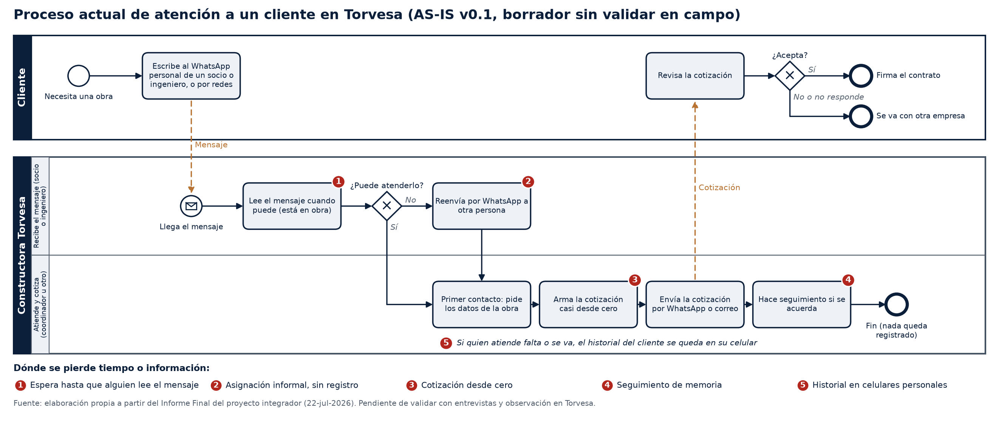

*Nota.* Elaboración propia con base en el informe final del proyecto integrador (Bermeo y Segura, 2026). El reenvío por WhatsApp (paso 3) y la forma de envío de la cotización (paso 6) son supuestos por confirmar.

El informe incluye un censo a las cinco personas de la gerencia y la operación de la empresa, aplicado en mayo de 2026 (Tabla 1). Por su tamaño se presenta como antecedente del diagnóstico y no como línea base.

**Tabla 1.** *Hallazgos del censo a la gerencia y la operación de Torvesa (n = 5)*

| Hallazgo | Frecuencia |
|---|---|
| Pasa más de la mitad de su jornada en obra | 3 de 5 |
| Revisa los mensajes de clientes cada 3 o 4 horas | 2 de 5 |
| Revisa los mensajes solo al llegar a casa | 1 de 5 |
| Los clientes le escriben a su WhatsApp personal | 4 de 5 |
| El tiempo máximo aceptable para el primer contacto es de menos de 15 minutos | 4 de 5 |
| Considera crítico revisar cada semana los motivos de pérdida de clientes | 3 de 5 |

*Nota.* Adaptado de Bermeo y Segura (2026, p. 10). Censo de mayo de 2026.

El censo muestra una brecha entre lo que la empresa espera y lo que ocurre: cuatro de las cinco personas fijan en menos de 15 minutos el tiempo máximo para el primer contacto, pero tres de las cinco revisan los mensajes cada tres o cuatro horas o solo al llegar a casa. La meta M1 es una decisión de diseño que coincide con ese límite fijado por la propia empresa; el censo no prueba que 15 minutos sea el plazo óptimo. La delegación informal y la pérdida de clientes frente a otras empresas no tienen cifra en el censo y siguen como supuestos por contrastar con la muestra documental.

### Puntos donde se pierde tiempo o información

El análisis del proceso identifica cinco puntos críticos (Tabla 2). Cada uno se relaciona con una meta de validación y con una función que el sistema debe cumplir; de esa relación salen los requisitos de la sección siguiente.

**Tabla 2.** *Puntos críticos del proceso actual y función que el sistema debe cumplir*

| Punto crítico | Qué pasa hoy | Función del sistema | Meta |
|---|---|---|---|
| 1. Espera | Nadie ve el mensaje hasta que revisa el celular | Registrar la solicitud y avisar al instante al celular del responsable | M1, M3 |
| 2. Asignación informal | La delegación no deja rastro ni un responsable claro | Asignar un único responsable, registrar cada cambio de estado y recordar a los 15 minutos | M1, M3 |
| 3. Cotización desde cero | Las cotizaciones anteriores están dispersas en celulares y cuadernos | Plantillas por tipo de obra y borrador propuesto por el asistente, revisado por una persona | M2 |
| 4. Seguimiento de memoria | Sin recordatorios, el interés del cliente se enfría | Fecha de seguimiento con recordatorio | — |
| 5. Historial en los celulares | Si un vendedor se va, se pierde lo que sabía del cliente | Ficha por cliente en la bóveda, que cualquier persona autorizada puede consultar | M4 |

*Nota.* Elaboración propia. Además, en todos los pasos el sistema debe dejar un registro verificable de cada evento (M5) y proteger los datos personales (LOPDP).

La Figura 2 ilustra el cambio que busca el diseño: de mensajes que esperan en un celular personal y papeles dispersos, a una solicitud con responsable y un historial que cualquier persona autorizada puede consultar.

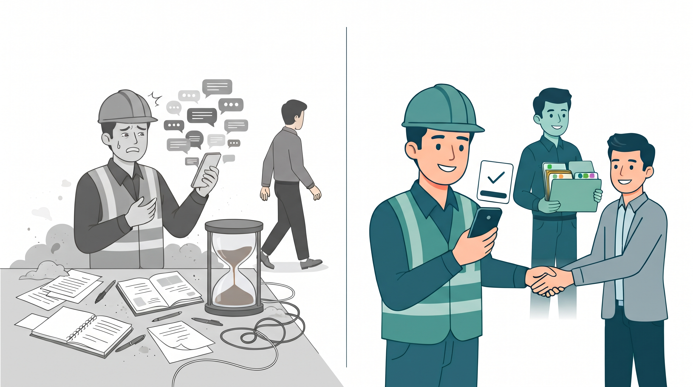

*Nota.* Ilustración generada con Gemini (Google) a partir de una descripción de los autores. No representa a personas reales ni resultados medidos.

### Línea base

La línea base de las metas M1 a M5 se calcula con documentos de la empresa (fechas y horas de las solicitudes de los últimos tres meses, sin datos de clientes) y con los casos de prueba del equipo [FALTA-DATO: línea base M1 y M3, muestra documental de Torvesa] [FALTA-DATO: línea base M2 y M4, casos de prueba del sprint 5]. [DECIDIR-TUTORA: la forma de medir depende de la propuesta de no recoger datos de personas (véase el capítulo III)]

### Contexto del sector entre 2023 y 2026

La construcción ecuatoriana cayó dos años seguidos y volvió a crecer en 2025 (Tabla 3). En 2025 representó el 4,1 % del PIB (Banco Central del Ecuador, 2026a, p. 22) y el 6,4 % del empleo del país (Banco Central del Ecuador, 2026a, p. 45).

**Tabla 3.** *Crecimiento anual de la construcción y del PIB del Ecuador, 2022–2025*

| Año | Construcción | PIB |
|---|---|---|
| 2022 | +7,5 % | +5,9 % |
| 2023 | −1,7 % | +1,8 % |
| 2024 | −7,9 % | −1,9 % (provisional) |
| 2025 | +2,7 % | +3,7 % (preliminar) |

*Nota.* Banco Central del Ecuador (2026a, p. 22).

Tres hechos del período condicionan el diseño. Primero, la crisis eléctrica de 2024: hubo cortes de luz de hasta 12 horas diarias en algunos sectores (Tapia, 2024) y, según el Banco Central, las pérdidas llegaron a USD 1.916 millones (Redacción Primicias, 2025). Por eso el diseño exige que las fichas de los clientes se puedan consultar sin conexión (RQ-14). Segundo, el cliente ya está en línea: a finales de 2025, el 83,9 % de la población usaba internet (Kemp, 2026). Tercero, las mipymes ecuatorianas usan poco la inteligencia artificial, y una de sus barreras es la falta de bases de datos estructuradas (Pérez-Campdesuñer et al., 2025); además, el 70 % de las organizaciones del país no tiene reglas internas para su uso (Revelo, 2026). De ahí que el primer paso del diseño sea ordenar la memoria comercial de la empresa, con reglas de protección de datos, antes de añadir el asistente. [FALTA-FUENTE: cifra nacional de uso de WhatsApp en los negocios]

### Análisis FODA de la propuesta

El análisis FODA (Figura 3) evalúa la propuesta, no a la empresa entera. Las fortalezas y las debilidades salen de la prueba de concepto y de la revisión del código; las oportunidades y las amenazas, del contexto anterior.

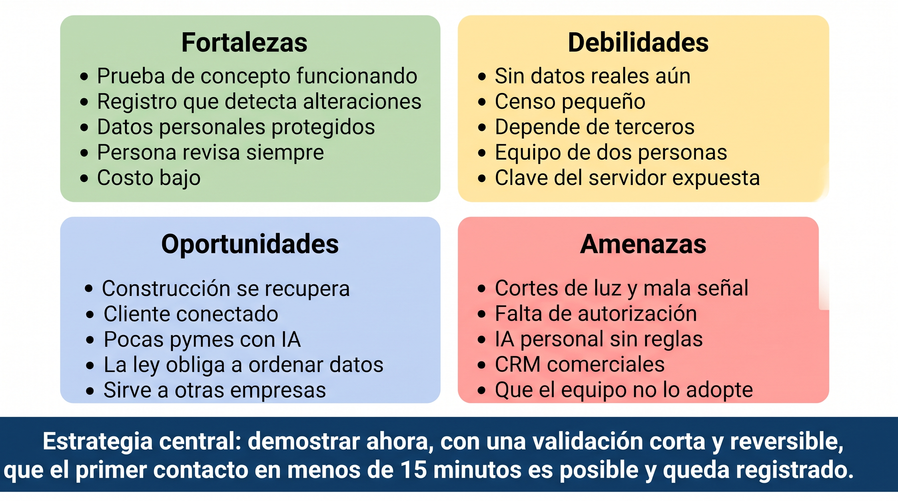

*Nota.* Elaboración propia. La imagen se compuso con Gemini (Google) a partir del texto de los autores, que se revisó palabra por palabra. La prueba de concepto usa solo datos ficticios.

De cruzar los cuatro cuadrantes salen las estrategias de la Tabla 4. La estrategia central es demostrar, con una validación corta y reversible, que el primer contacto en menos de 15 minutos es posible y queda registrado.

**Tabla 4.** *Estrategias que resultan del análisis FODA*

| Tipo | Estrategia |
|---|---|
| Fortalezas y oportunidades | Presentar a la gerencia la prueba de concepto en funcionamiento, mientras la demanda del sector se recupera |
| Fortalezas y oportunidades | Presentar el cumplimiento de la LOPDP como un beneficio del sistema |
| Debilidades y oportunidades | Pedir a la empresa solo las fechas y horas de las solicitudes de tres meses, sin datos de clientes, para calcular la línea base |
| Debilidades y oportunidades | Separar las claves de acceso del servidor antes de usar datos reales |
| Fortalezas y amenazas | Fichas consultables sin conexión, para trabajar con cortes de luz o mala señal |
| Fortalezas y amenazas | Proponer una validación de dos semanas que no compromete a la empresa |
| Debilidades y amenazas | Empezar con lo mínimo que el equipo usa: el aviso de texto y el botón «Tomar» |
| Debilidades y amenazas | Dejar manuales y la bóveda documentada, para que el sistema no dependa de los autores |

*Nota.* Elaboración propia.

## Diseño del sistema

### Requisitos

Los requisitos se obtuvieron con un proceso de elicitación y análisis basado en la norma ISO/IEC/IEEE 29148 y en la guía SWEBOK [FALTA-DATO: ficha de la norma ISO/IEC/IEEE 29148 y de SWEBOK en la base de fuentes]. La primera iteración partió de los documentos del proyecto integrador y del código de TEAMSLASH, revisado el 2 de noviembre de 2026. Cada requisito tiene un identificador, la necesidad de la que sale, un criterio de aceptación y la forma de verificarlo. La Tabla 5 resume los 24 requisitos; la versión completa, con su trazabilidad, va en el Anexo 2.

**Tabla 5.** *Requisitos del sistema*

| Código | Requisito (resumen) | Tipo | Meta |
|---|---|---|---|
| RQ-01 | Registrar cada solicitud del formulario con fecha y hora de ingreso en 5 segundos o menos | Funcional | M1 |
| RQ-02 | Enviar una alerta al celular del responsable en 5 segundos o menos, con enlace a la ficha del cliente | Funcional | M1 |
| RQ-03 | Registrar desde el celular una solicitud recibida por WhatsApp o por teléfono, con la hora real de llegada | Funcional | M1, M3 |
| RQ-04 | Asignar cada solicitud a un único responsable y registrar la asignación | Funcional | M1 |
| RQ-05 | Registrar el estado de cada solicitud: Nueva, En contacto, Cotizada, Ganada o Perdida | Funcional | M1, M3 |
| RQ-06 | A los 15 minutos sin primer contacto, recordar al responsable y avisar a la gerencia | Funcional | M1, M3 |
| RQ-07 | Exigir un motivo de una lista cerrada al marcar una solicitud como Perdida | Funcional | M3 |
| RQ-08 | Generar cada lunes un reporte con la mediana del tiempo de primer contacto, los estados y los motivos de pérdida | Funcional | M1, M3 |
| RQ-09 | Mantener en la bóveda una ficha por cliente, con código, y su historial de solicitudes y cotizaciones | Funcional | M4 |
| RQ-10 | Mantener en la bóveda plantillas de cotización por tipo de obra | Funcional | M2 |
| RQ-11 | Generar con el asistente un borrador de respuesta o de cotización e indicar qué documentos usó | Funcional | M2 |
| RQ-12 | Exigir la revisión y la aprobación de una persona antes de enviar cualquier borrador al cliente | No funcional | M2 |
| RQ-13 | Buscar un cliente por código, nombre o tipo de obra y mostrar su historial completo | Funcional | M4 |
| RQ-14 | Mostrar sin conexión las fichas ya sincronizadas en el celular | No funcional | M4 |
| RQ-15 | Guardar cada evento en un registro de solo agregar, con su huella SHA-256 y la del evento anterior | Funcional | M5 |
| RQ-16 | Verificar la integridad del registro y señalar cada evento alterado | Funcional | M5 |
| RQ-17 | Guardar en el registro verificable solo huellas y códigos, sin datos personales | Normativo | — |
| RQ-18 | Pedir en el formulario el consentimiento del prospecto, con enlace al aviso de privacidad | Normativo | — |
| RQ-19 | Eliminar o anonimizar los datos de los prospectos perdidos al cumplirse el plazo de conservación | Normativo | — |
| RQ-20 | Dar acceso solo a cuentas individuales autorizadas por la gerencia | No funcional | — |
| RQ-21 | Enviar al servicio de IA solo códigos de cliente, nunca nombres, teléfonos ni correos | Normativo | — |
| RQ-22 | Alcanzar una usabilidad aceptable al final de la validación | No funcional | M6 |
| RQ-23 | Validar el diseño en operación experimental controlada durante dos semanas | De proyecto | — |
| RQ-24 | Guardar la hora del primer contacto de cada solicitud | Funcional | M1 |

*Nota.* Elaboración propia a partir del documento de elicitación y análisis de requerimientos, versión 0.1 (27 de octubre de 2026), con la revisión técnica del 2 de noviembre de 2026. RQ-22 cambia si se acepta la propuesta de medir la usabilidad sin cuestionarios (capítulo III).

La priorización combinó el valor para el negocio, la urgencia, el costo y el riesgo de cada requisito. Quedaron con prioridad alta el registro de la solicitud, la alerta, el registro manual de lo que llega por WhatsApp, el responsable único, los estados, la revisión humana de los borradores y los tres requisitos de protección de datos (RQ-17, RQ-18 y RQ-21). El borrador con IA (RQ-11) y el registro de solo agregar (RQ-15) quedaron con prioridad baja por su costo y su riesgo técnico, aunque son parte del aporte del proyecto; por eso se acotan: el asistente solo propone borradores que una persona revisa (RQ-12).

### Casos de uso y modelo conceptual

La Figura 4 muestra los 12 casos de uso del sistema y sus actores: el prospecto o cliente, el coordinador comercial, quien cotiza, los colaboradores, la gerencia y tres sistemas externos (el canal de alertas, el servicio de IA y el reloj del sistema). Cada caso de uso tiene un escenario operacional y está ligado a sus requisitos.

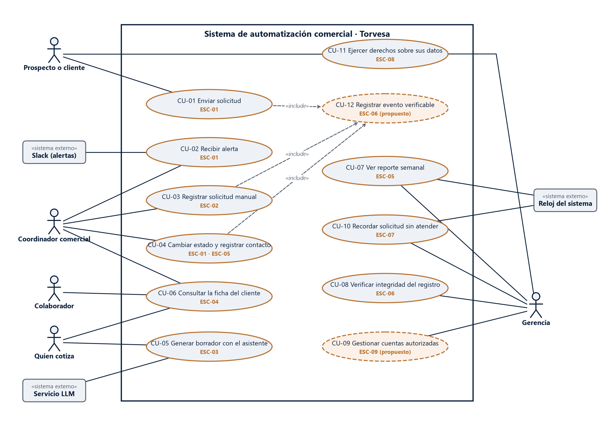

*Nota.* Elaboración propia. CU-12 (registrar evento verificable) se incluye en todos los casos que cambian algo en el sistema.

El modelo conceptual (Figura 5) muestra la información que el sistema debe conservar y cómo se relaciona. Tres decisiones de diseño se ven en él. Primero, los datos personales viven en un solo lugar, la ficha de contacto del cliente; el resto de registros nombra al cliente solo por su código, de modo que se puede borrar a un cliente sin romper la cadena de huellas. Segundo, la asignación y los cambios de estado se guardan como registros propios, porque TEAMSLASH solo conserva el estado actual y, sin historial, no se puede medir el tiempo de primer contacto. Tercero, cada cotización guarda la huella del documento enviado y los documentos que usó el asistente.

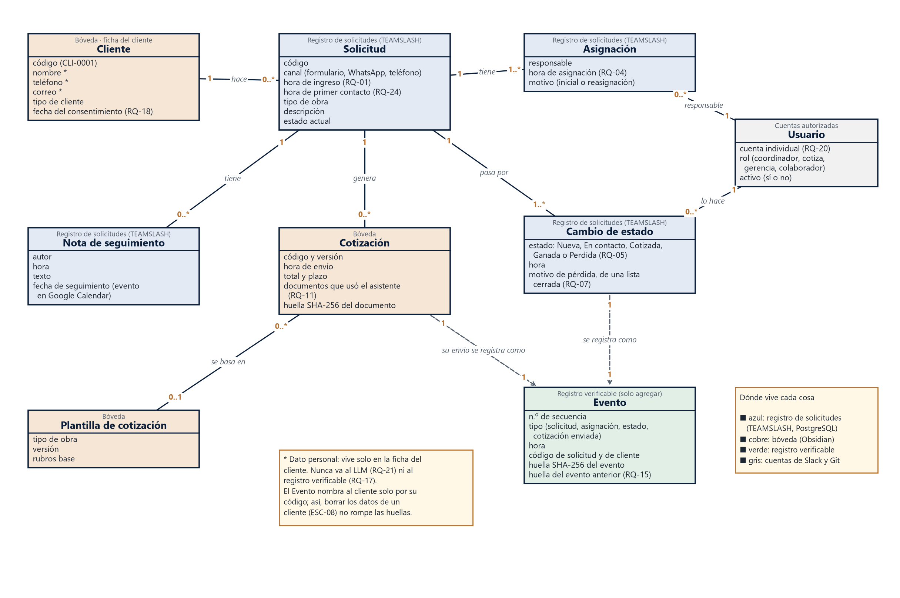

*Nota.* Elaboración propia. Los colores indican dónde vive cada dato: registro de solicitudes (TEAMSLASH), bóveda (Obsidian), registro verificable y cuentas.

### Proceso con el sistema (TO-BE)

El proceso con el sistema se dibujó en BPMN en tres partes, con seis pasos (P1 a P6) y un responsable y un disparador para cada tarea.

La primera parte (Figura 6) cubre la recepción, la asignación, el aviso y el primer contacto. La solicitud entra por el formulario web, con el consentimiento del cliente, o la registra el coordinador desde el celular si llegó por WhatsApp o por teléfono. El sistema le asigna un código, crea o actualiza la ficha del cliente en la bóveda, designa a un único responsable y le envía una alerta con un enlace a esa ficha. Cuando el responsable contacta al cliente y marca «En contacto», el sistema guarda la hora del primer contacto, que es el dato con el que se mide M1.

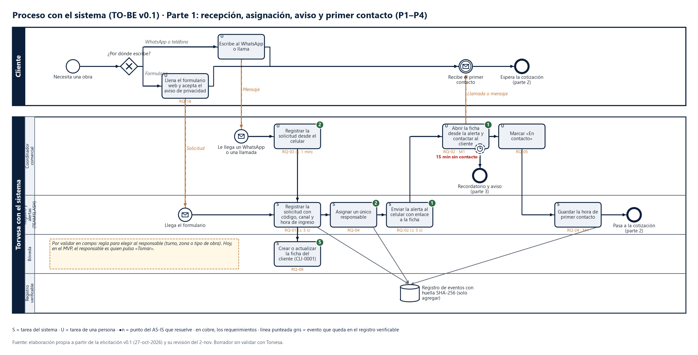

*Nota.* Elaboración propia.

La segunda parte (Figura 7) cubre la cotización asistida y el traspaso del cliente. Quien cotiza pide un borrador desde la ficha; el asistente busca la plantilla del tipo de obra y las cotizaciones anteriores, propone el borrador y cita los documentos que usó. Una persona revisa rubros, precios y plazos antes de enviarlo; el sistema nunca envía nada por sí solo. Al enviarla, se guarda la huella del documento y la solicitud pasa a «Cotizada». Si un cliente llama y su vendedor no está, otra persona busca la ficha y lo atiende sin pedirle que repita su historia.

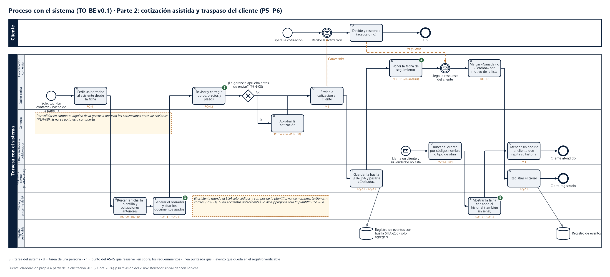

*Nota.* Elaboración propia. La aprobación de la gerencia antes del envío está dibujada como opcional hasta confirmar si existe en la empresa [FALTA-DATO: si la gerencia aprueba las cotizaciones antes de enviarlas].

La tercera parte (Figura 8) reúne tres flujos que arrancan solos, por tiempo o por un hecho: el recordatorio a los 15 minutos sin primer contacto, con aviso a la gerencia y reasignación si sigue sin atenderse; el recordatorio de seguimiento después de cotizar; y la reasignación de las solicitudes abiertas cuando un vendedor deja la empresa, cuyas fichas permanecen en la bóveda.

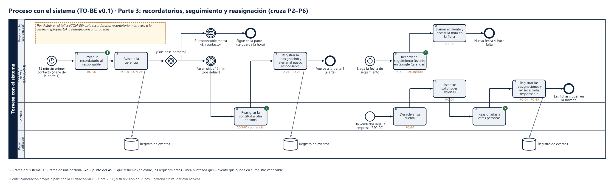

*Nota.* Elaboración propia. El segundo plazo de 15 minutos para la reasignación es un supuesto por validar con la empresa.

### Proceso central y escalabilidad

De los cinco puntos críticos, la espera y la asignación informal forman el proceso central del diseño: son los que más afectan a la empresa hoy, se pueden medir con las horas que guarda el sistema y ya funcionan en la prueba de concepto. Este proceso, el primer contacto en menos de 15 minutos con responsable y registro, tiene ocho pasos (Tabla 6 y Figura 9). [DECIDIR-VÍCTOR: nombre del proceso; se propone «Primer contacto garantizado»]

**Tabla 6.** *Pasos del proceso central*

| Paso | Qué pasa | Quién | Tiempo objetivo |
|---|---|---|---|
| 1. Captura | La solicitud entra por el formulario, con consentimiento, o se registra desde el celular si llegó por WhatsApp o teléfono | Cliente o coordinador | Al llegar |
| 2. Código y registro | El sistema le da un código y guarda la hora de llegada en el registro con huellas | Sistema | 5 segundos o menos |
| 3. Aviso | Llega una tarjeta al celular del equipo, con un enlace a la ficha | Sistema | 5 segundos o menos |
| 4. Tomar | Alguien pulsa «Tomar» y queda como único responsable | Responsable | Antes del minuto 15 |
| 5. Primer contacto | El responsable contacta al cliente y el sistema guarda la hora | Responsable | Antes del minuto 15 |
| 6. Escalamiento | Si nadie tomó la solicitud, se recuerda al equipo y se avisa a la gerencia | Sistema | Minuto 15 |
| 7. Cierre con motivo | Si el cliente se pierde, el motivo es obligatorio | Responsable | Al cerrar |
| 8. Reporte semanal | Tiempo de primer contacto, estados, motivos de pérdida y la última huella del registro | Sistema | Cada lunes |

*Nota.* Elaboración propia. Los tiempos son objetivos de diseño; se medirán en la validación.

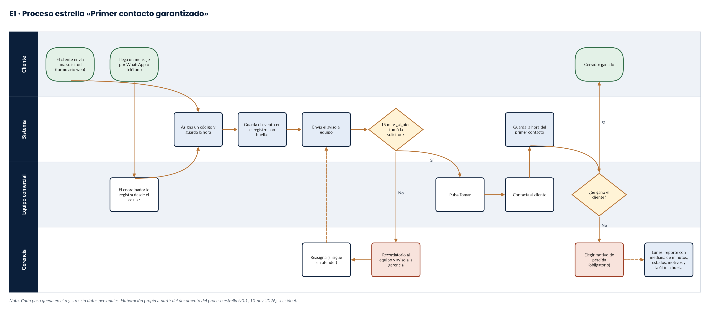

*Nota.* Elaboración propia.

El diseño se organiza en tres niveles, y cada uno necesita el anterior (Tabla 7). El primero sirve a cualquier empresa que recibe solicitudes de clientes y cuyo personal trabaja fuera de la oficina; lo que cambia de una empresa a otra es la configuración (tipos de trabajo, plantillas, plazo objetivo y canales), no el núcleo. Cada empresa tendría su propia base de datos y su propia bóveda, de modo que los datos de clientes de dos empresas nunca se mezclan.

**Tabla 7.** *Niveles del diseño y posibilidad de aplicarlo en otras empresas*

| Nivel | Qué incluye | A quién le sirve |
|---|---|---|
| 1. Primer contacto con responsable y registro | Captura, aviso, responsable único, recordatorio a los 15 minutos, motivo de pérdida, reporte semanal y registro con huellas | Constructoras, empresas de remodelación, inmobiliarias y proveedores de materiales |
| 2. Memoria comercial | Bóveda con la ficha y el historial de cada cliente, plantillas y consulta sin conexión | Empresas con rotación de personal o con varios vendedores; exige ordenar antes sus datos |
| 3. Cotización asistida | Borrador de cotización con el asistente, sin precios, con los documentos citados y revisado por una persona | Empresas que cotizan trabajos parecidos con frecuencia |

*Nota.* Elaboración propia. La aplicación en otras empresas es una proyección del diseño; este trabajo solo lo evalúa en Torvesa.

El proceso central se controla con indicadores que el propio sistema calcula (Tabla 8). [FALTA-FUENTE: normas ISO/IEC 25010 e ISO 9001, que se usarán solo como marco para ordenar los indicadores, sin certificación]

**Tabla 8.** *Indicadores del proceso central*

| Indicador | Cómo se calcula | Meta |
|---|---|---|
| Tiempo de primer contacto | Mediana de la hora del primer contacto menos la hora de llegada | Menos de 15 minutos (M1) |
| Solicitudes atendidas dentro del plazo | Atendidas antes del plazo entre el total | [DECIDIR-VÍCTOR: meta; se propone 80 % o más] |
| Solicitudes con responsable | Con responsable entre el total | 100 % |
| Pérdidas con motivo | Perdidas con motivo entre el total de perdidas | 100 % (M3) |
| Alteraciones detectadas | Detectadas entre las simuladas | 100 % (M5) |
| Datos personales enviados al asistente | Solicitudes con datos personales en lo enviado entre el total | 0 % |

*Nota.* Elaboración propia.

### Componentes del sistema

La Figura 10 muestra cómo se conectan los componentes. El registro de solicitudes es TEAMSLASH, que ya existe: un formulario web, una API propia y una base de datos PostgreSQL, con alertas por Slack (Bermeo y Segura, 2026, p. 5). Sobre él se diseñan tres componentes nuevos: la bóveda de conocimiento comercial, el asistente de IA y el registro verificable.

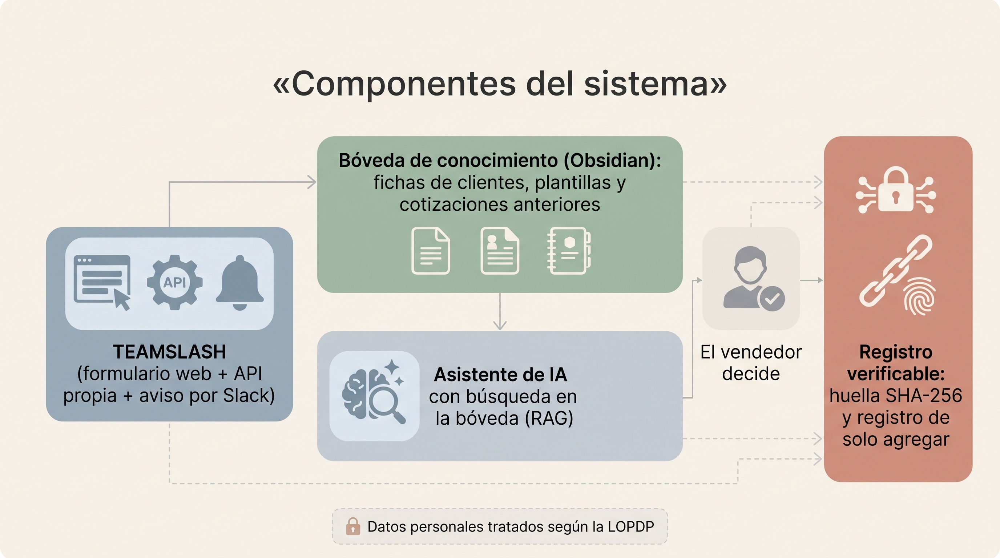

*Nota.* Elaboración propia.

La revisión técnica de TEAMSLASH del 2 de noviembre de 2026 mostró qué parte del diseño ya existía y qué era nuevo. El 8 de noviembre el sistema volvió a estar en línea y la prueba de concepto recorrió el flujo completo con datos ficticios (Figura 11). La Tabla 9 resume el estado de cada función.

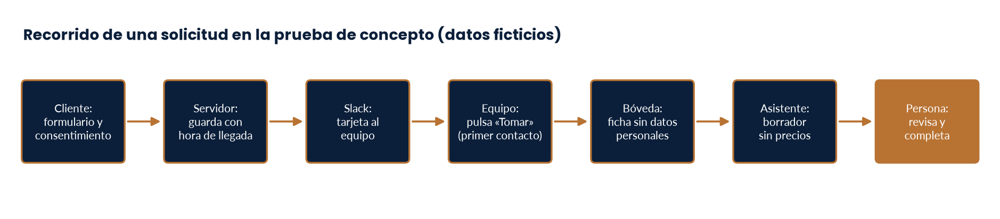

*Nota.* Elaboración propia. Slack es el servicio de mensajería por el que el equipo recibe los avisos. Todas las solicitudes de la prueba son ficticias.

**Tabla 9.** *Funciones de TEAMSLASH y estado de las funciones nuevas al 8 de noviembre de 2026*

| Función | Estado |
|---|---|
| Formulario web que registra la solicitud con un código de cliente | Ya existía |
| Aviso al equipo con botones de estado; quien pulsa «Tomar» queda como responsable | Ya existía |
| Notas con autor y fecha, y fecha de seguimiento en el calendario | Ya existía |
| Casilla de consentimiento obligatoria en el formulario (RQ-18) | Nueva; funciona en la prueba de concepto |
| Hora del primer contacto (RQ-24) | Nueva; funciona en la prueba de concepto |
| Registro verificable con huellas SHA-256 encadenadas (RQ-15 a RQ-17) | Nueva; funciona. En una primera prueba detectó tres de tres alteraciones |
| Bóveda, plantillas de cotización y asistente (RQ-09 a RQ-12 y RQ-21) | Nuevas; funcionan como prueba de concepto |
| Cinco estados, motivo de pérdida obligatorio, recordatorio a los 15 minutos y reporte semanal (RQ-05 a RQ-08) | Programadas; falta publicarlas y probarlas [FALTA-DATO: versión publicada, por confirmar con el servidor] |

*Nota.* Elaboración propia a partir de la revisión del código (2 y 10 de noviembre de 2026) y del reporte de la prueba de concepto (8 de noviembre de 2026).

### La bóveda de conocimiento comercial

La bóveda es una carpeta de notas en Obsidian que guarda la memoria comercial de la empresa, de modo que ya no dependa del celular de cada vendedor. Su versión 0.1, con datos ficticios, tiene la estructura de la Tabla 10.

**Tabla 10.** *Estructura de la bóveda de conocimiento comercial*

| Carpeta | Qué guarda | Requisito |
|---|---|---|
| Clientes | Una ficha por cliente, identificada con un código y sin datos personales | RQ-09 |
| Solicitudes | Estado, responsable, hora de ingreso y hora de primer contacto | RQ-05, RQ-24 |
| Cotizaciones | Cada cotización enviada, los documentos que usó el asistente y su huella | RQ-11, RQ-15 |
| Plantillas de cotización | Una por tipo de obra, con los rubros y sin precios | RQ-10 |
| Equipo | Una nota por vendedor, con su rol y si está activo | RQ-20 |
| Contactos | Nombre, teléfono y correo: lo único con datos personales; el asistente no la lee | RQ-19, RQ-21 |
| Tableros | Pendientes por vendedor, clientes por responsable y cotizaciones que esperan respuesta | RQ-08 |

*Nota.* Elaboración propia. Los tableros usan la función Bases, incluida en Obsidian, sin complementos adicionales.

Como Obsidian no permite dar permisos distintos a cada usuario dentro de una misma bóveda (Obsidian, s. f.), los datos personales se separan en una sola carpeta, que el asistente nunca consulta. [DECIDIR-VÍCTOR: si la carpeta de contactos va en una bóveda aparte, a la que solo accede quien atiende] [DECIDIR-VÍCTOR: sincronización en el celular con el complemento de Git (gratuito, pero inestable en el móvil) o con Obsidian Sync (de pago)]

### Protección de datos personales

El diseño aplica la minimización de datos en cuatro puntos: el formulario pide el consentimiento antes de enviar la solicitud (RQ-18); el registro verificable solo guarda huellas y códigos (RQ-17); el asistente envía al servicio de IA solo códigos, nunca nombres ni teléfonos (RQ-21); y los datos de los prospectos perdidos se eliminan o se anonimizan al vencer el plazo de conservación que fije la gerencia (RQ-19) [FALTA-DATO: plazo de conservación, a definir con la gerencia de Torvesa]. El desarrollo normativo de estos controles, con los artículos de la LOPDP, se completa en el sprint 5.

### Herramientas, costos y viabilidad económica

**Aviso sobre las cifras.** Los precios de esta sección son los oficiales de cada proveedor, consultados entre el 21 de octubre y el 10 de noviembre de 2026. Los volúmenes, los sueldos y los montos de la empresa son supuestos del equipo, porque Torvesa aún no entrega su información [FALTA-DATO: solicitudes por mes, clientes perdidos antes del primer contacto, valor promedio de una obra, margen y tasa de cierre]. Los resultados cambian cuando esos datos lleguen.

**Selección de herramientas.** Se compararon once alternativas con nueve criterios ponderados (Tabla 11): el costo total a tres años y la protección de datos pesan 20 % cada uno; la facilidad de adopción, 15 %; el funcionamiento con mala conexión, la integración con WhatsApp y con el servicio de avisos, y la escalabilidad, 10 % cada uno; y la dependencia del proveedor, el registro verificable y el soporte en español, 5 % cada uno. El costo se puntúa con una fórmula y los demás criterios, de 1 a 5, con la evidencia de cada puntaje.

**Tabla 11.** *Resultado de la matriz de decisión de herramientas*

| Puesto | Alternativa | Puntaje (de 5) | Costo total a tres años |
|---|---|---|---|
| 1 | Herramientas de la prueba de concepto (servidor propio, mensajería, Obsidian y asistente por consumo) | 4,14 | USD 9.039 |
| 2 | Las mismas herramientas con otro modelo de IA | 3,99 | USD 9.019 |
| 3 a 6 | CRM comercial (Pipedrive, HubSpot, Zoho u Odoo) más el formulario actual | 3,55 a 3,36 | USD 9.115 a 10.771 |
| 7 | Servicios de Amazon Web Services con búsqueda en documentos gestionada | 3,23 | USD 13.583 |
| 8 | Bitrix24 más el formulario actual | 3,15 | USD 8.959 |
| 9 y 10 | Microsoft Dynamics 365 | 3,09 y 2,99 | USD 21.286 y 29.866 |
| 11 | Amazon Web Services con un modelo propio entrenado | 2,06 | USD 724.428 |

*Nota.* Elaboración propia. Los puntajes cualitativos son una valoración del equipo. El costo total incluye supuestos de uso. [DECIDIR-TUTORA: criterios y pesos de la matriz]

Las herramientas de la prueba de concepto obtienen el mayor puntaje con cinco de los seis juegos de pesos que se probaron. Los CRM comerciales cubren el seguimiento de las ventas, pero no la memoria comercial, ni el asistente que cita los documentos de la empresa, ni el registro verificable. Entrenar un modelo propio queda en último lugar por tres razones: la empresa no tiene un historial digitalizado con el cual entrenarlo; mantenerlo en servicio cuesta USD 23,50 por hora (Amazon Web Services [AWS], s. f.-a), unos USD 17.155 al mes; y el propio proveedor recomienda empezar por la búsqueda en los documentos de la empresa cuando las respuestas deben apoyarse en ellos (AWS, s. f.-b), que es lo que exige el diseño (RQ-11). Esa alternativa queda como ruta de crecimiento si el sistema llega a ofrecerse a varias empresas.

**Inversión inicial y gasto de operación.** Desde el punto de vista de Torvesa, las suscripciones a servicios en la nube son gasto de operación, porque la empresa paga por el acceso y no adquiere un activo (IFRS Interpretations Committee, 2021). La inversión inicial reúne el desarrollo del programa propio, la capacitación y una reserva para imprevistos. No se prevé comprar equipos, porque el personal ya tiene celular con datos (supuesto). El gasto de operación incluye el impuesto al valor agregado, que los servicios digitales del exterior causan al momento del pago (Servicio de Rentas Internas [SRI], 2021, p. 1); el modelo usa la tarifa del 15 % [VERIFICAR-PÁG: tarifa vigente, Decreto Ejecutivo 198].

**Resultados.** El análisis cubre tres años y tres escenarios (Tabla 12). La tasa de descuento del escenario optimista es la tasa activa máxima para las pymes, de 9,87 % (Banco Central del Ecuador, 2026b); la del escenario base suma dos puntos por riesgo tecnológico (12 %, supuesto), y la del pesimista es de 15 %, la tasa que usó el proyecto integrador (Bermeo y Segura, 2026, p. 28). El costo de la hora de trabajo parte del salario básico de 2026, de USD 482 (Ministerio del Trabajo, 2026, p. 2).

**Tabla 12.** *Resultados del análisis financiero a tres años, por escenario*

| Indicador | Pesimista | Base | Optimista |
|---|---|---|---|
| Inversión inicial | USD 4.451 | USD 2.893 | USD 1.723 |
| Gasto de operación al año | USD 3.066 | USD 2.213 | USD 1.707 |
| Beneficio anual estimado | USD 633 | USD 9.262 | USD 30.773 |
| Valor actual neto (VAN) | −USD 10.282 | USD 11.557 | USD 66.526 |
| Tasa interna de retorno (TIR) | No existe | 171 % | 1.436 % |
| Retorno sobre la inversión a tres años (ROI) | −88 % | 162 % | 1.182 % |
| Período de recuperación | Más de tres años | Unos ocho meses | Menos de un mes |
| VAN sin contar ventas recuperadas | −USD 10.282 | USD 33 | USD 23.778 |
| Obras al año que cubren el costo del sistema, sin ahorro de tiempo | 9,7 | 2,6 | 1,2 |

*Nota.* Elaboración propia con el modelo financiero del Anexo 5. Antes de impuesto a la renta, en dólares constantes y sin valor residual. Los beneficios son supuestos [FALTA-DATO: línea base de M2, M3 y M4].

Tres lecturas salen de la tabla. Primero, la viabilidad depende de recuperar clientes y no del ahorro de tiempo: sin ventas recuperadas, el VAN del escenario base es casi cero. Segundo, con los supuestos del escenario base, el sistema cubre su costo si la empresa recupera alrededor de tres obras al año, un umbral que la gerencia puede comparar con su experiencia y que se contrastará con la línea base. Tercero, el escenario pesimista es negativo: con pocas solicitudes y ninguna venta recuperada, el sistema no se paga en tres años. La TIR resulta muy alta porque la inversión es pequeña, por lo que el VAN y el umbral de obras describen mejor el resultado. El escenario optimista reúne todos los supuestos favorables a la vez y no es una proyección esperada.

El análisis de sensibilidad confirma esa lectura (Tabla 13): los cinco supuestos que más mueven el VAN son de ventas, y todos dependen de datos de la empresa. El costo del asistente casi no influye.

**Tabla 13.** *Supuestos que más cambian el VAN del escenario base*

| Orden | Supuesto | Variación del VAN |
|---|---|---|
| 1 | Reducción de los clientes perdidos con el sistema | USD 16.133 |
| 2 | Solicitudes nuevas por mes | USD 12.487 |
| 3 | Clientes perdidos antes del primer contacto | USD 8.643 |
| 4 | Valor promedio de una obra | USD 7.682 |
| 5 | Tasa de cierre | USD 5.762 |
| 6 | Horas por semana dedicadas a buscar el historial | USD 4.716 |
| 7 | Sueldo de quien cotiza | USD 4.690 |

*Nota.* Elaboración propia. Cada supuesto se movió, uno a la vez, de su valor pesimista a su valor optimista.

El modelo de negocio de TEAMSLASH como servicio va como anexo de contexto.

### Riesgos del diseño

**Tabla 14.** *Riesgos principales del diseño y su mitigación*

| Riesgo | Probabilidad | Impacto | Mitigación |
|---|---|---|---|
| La empresa no autoriza a tiempo el acceso a sus documentos | Media | Alto | Los requisitos de la primera iteración permiten avanzar con el diseño; la medición se apoya en casos de prueba |
| Las solicitudes que llegan por WhatsApp no se registran y la medición queda incompleta | Media | Alto | Registro manual en un minuto o menos y enlace al formulario |
| El asistente inventa precios o rubros | Media | Alto | Revisión humana obligatoria (RQ-12) y cita de los documentos usados |
| Caídas o cambios de precio de servicios de terceros | Baja | Medio | Planes gratuitos o por consumo y alternativas documentadas |
| Pocas solicitudes en las dos semanas de validación | Media | Medio | Resultados descriptivos y casos de prueba complementarios |
| La clave de acceso del servidor está visible en la página pública y permite leer las solicitudes | Alta | Alto | Separar una clave que solo permita enviar el formulario y otra, privada, para leer; cambiar la actual antes de usar datos reales |
| Borrar los últimos eventos del registro no se detecta | Baja | Medio | Publicar cada semana la última huella en el reporte a la gerencia [DECIDIR-VÍCTOR: aprobar esta medida] |
| El análisis financiero se apoya en supuestos | Alta | Medio | Presentar tres escenarios y reemplazar los supuestos con la línea base de la empresa |

*Nota.* Elaboración propia a partir del documento de elicitación (sección 14.2) y de la revisión del código del 10 de noviembre de 2026. El riesgo de que la versión publicada no estuviera en línea se cerró el 8 de noviembre de 2026. La matriz completa de riesgos se entrega en el sprint 5.

## Referencias

Banco Central del Ecuador. (2026a). *Informe de evolución de la economía ecuatoriana en 2025 y perspectivas 2026*. https://contenido.bce.fin.ec/documentos/Administracion/EvolEconEcu_2025pers2026.pdf

Kemp, S. (2026). *Digital 2026: Ecuador*. DataReportal. https://datareportal.com/reports/digital-2026-ecuador

Pérez-Campdesuñer, R., Sánchez-Rodríguez, A., García-Vidal, G., Martínez-Vivar, R., y De Miguel-Guzmán, M. (2025). Artificial intelligence in Ecuadorian SMEs: Drivers and obstacles to adoption. *Information, 16*(6), 443.

Redacción Primicias. (2025, 15 de abril). La economía de Ecuador cayó en recesión en 2024, confirma el Banco Central. *Primicias*. https://primicias.ec/economia/economia-ecuador-recesion-bce-crisis-electrica-iva-94029

Revelo, R. (2026, 16 de septiembre). El peligro de la «Shadow AI»: el 33 % de empleados en Ecuador usa IA personal en el trabajo. *Primicias*.

Tapia, E. (2024, 23 de octubre). Ecuador cumple un mes con largos apagones que llegaron hasta 12 horas, ¿cuáles son los efectos en el país? *Primicias*. https://primicias.ec/economia/primer-mes-apagones-ecuador-perdidas-industrias-81725

Amazon Web Services. (s. f.-a). *Amazon Bedrock pricing*. Recuperado el 10 de noviembre de 2026, de https://aws.amazon.com/bedrock/pricing/

Amazon Web Services. (s. f.-b). *Comparing Retrieval Augmented Generation and fine-tuning*. AWS Prescriptive Guidance. Recuperado el 10 de noviembre de 2026, de https://docs.aws.amazon.com/prescriptive-guidance/latest/retrieval-augmented-generation-options/rag-vs-fine-tuning.html

Banco Central del Ecuador. (2026b). *Tasas de interés activas efectivas máximas y referenciales, noviembre 2026*. Recuperado el 10 de noviembre de 2026, de https://contenido.bce.fin.ec/documentos/Estadisticas/SectorMonFin/TasasInteres/Indice.htm

IFRS Interpretations Committee. (2021, marzo). *IFRIC Update March 2021*. IFRS Foundation. https://www.ifrs.org/content/ifrs/home/news-and-events/updates/ifric/2021/ifric-update-march-2021.html

Ministerio del Trabajo. (2026). *Informe de gestión, rendición de cuentas, acciones relevantes: Subsecretaría de Empleo y Salarios. Periodo: enero a diciembre 2025*. https://www.trabajo.gob.ec/wp-content/uploads/2026/03/Anexo-Fijacion-Salario-Basico-Planta-Central-2025.pdf

Servicio de Rentas Internas. (2021). *Guía para la interpretación de las directrices del catastro de prestadores de servicios digitales para los intermediarios que actúen como agentes de retención*. https://www.sri.gob.ec/o/sri-portlet-biblioteca-alfresco-internet/descargar/b5a61f8e-f8c8-4dc1-9b30-365f2d16b4b6/Gu%C3%ADa%20para%20Implementaci%C3%B3n%20del%20Catastro.pdf
