<!--
Versión para la IA. Lo agregado el 16-nov va entre   y lo quitado entre ; el armador del borrador acepta los cambios.
-->

# CAPÍTULO IV

# DESARROLLO TÉCNICO

Este capítulo reúne las dos primeras actividades de la investigación en ciencia del diseño aplicadas al caso: la identificación del problema con evidencia de la empresa (diagnóstico) y el diseño del artefacto. En DSR, la descripción del artefacto ocupa el lugar de los resultados de un trabajo empírico, por lo que aquí se presentan los requisitos, los procesos con el sistema, sus componentes y las decisiones de diseño con su justificación. [DECIDIR-TUTORA: el manual de estilo une el diagnóstico y el diseño en un solo capítulo, "Desarrollo técnico"; se consulta si el diagnóstico puede ser un capítulo propio]

## Diagnóstico del proceso actual

### Cómo se levantó el proceso actual

El proceso actual (AS-IS) se modeló con la notación BPMN 2.0, pensada para que la entiendan tanto las personas del negocio como las técnicas (Object Management Group, 2013, p. 1), con un carril por cada rol, que es la forma en que los empleados de una empresa mediana mejor reconocen quién hace cada paso (Nizioł et al., 2021, p. 199). Se siguió el orden que usan estudios recientes en organizaciones ecuatorianas y latinoamericanas: primero se arma un borrador con los documentos disponibles y después se contrasta con la evidencia de la empresa (Zambrano Loor y García Vera, 2025, p. 79; Martínez Mendoza et al., 2023, p. 4836). En esta versión, la fuente es el informe final del proyecto integrador TEAMSLASH (Bermeo y Segura, 2026). Por eso el modelo es preliminar: dos de sus pasos son supuestos y todos se contrastarán con la muestra de solicitudes de la empresa [FALTA-DATO: autorización de Torvesa para revisar las solicitudes de los últimos tres meses].

### El proceso actual de atención a un cliente

La Figura 1 muestra el proceso actual en ocho pasos. El cliente escribe al WhatsApp personal de un socio o de un ingeniero, o por redes sociales (Bermeo y Segura, 2026, p. 4). Quien recibe el mensaje suele estar en obra y lo lee cuando puede; si no puede atenderlo, lo delega por canales informales (Bermeo y Segura, 2026, p. 7). Quien atiende hace el primer contacto, arma la cotización casi desde cero, la envía y hace el seguimiento si lo recuerda. Al final, el cliente acepta o se va con otra empresa, sin que quede registrado el motivo (Bermeo y Segura, 2026, p. 4).

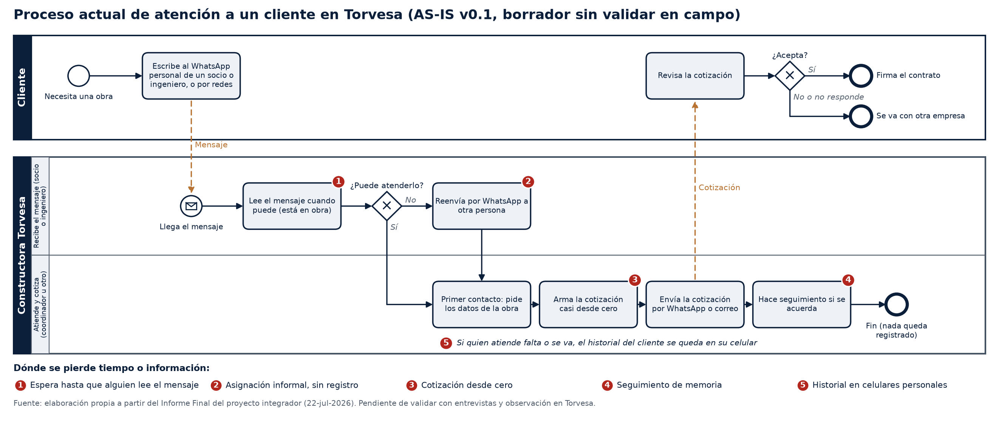

*Nota.* Elaboración propia con base en el informe final del proyecto integrador (Bermeo y Segura, 2026). El reenvío por WhatsApp (paso 3) y la forma de envío de la cotización (paso 6) son supuestos por confirmar.

El informe incluye un censo a las cinco personas de la gerencia y la operación de la empresa, aplicado en mayo de 2026 (Tabla 1). Por su tamaño se presenta como antecedente del diagnóstico y no como línea base.

**Tabla 1.** *Hallazgos del censo a la gerencia y la operación de Torvesa (n = 5)*

| Hallazgo | Frecuencia |
|---|---|
| Pasa más de la mitad de su jornada en obra | 3 de 5 |
| Revisa los mensajes de clientes cada 3 o 4 horas | 2 de 5 |
| Revisa los mensajes solo al llegar a casa | 1 de 5 |
| Los clientes le escriben a su WhatsApp personal | 4 de 5 |
| El tiempo máximo aceptable para el primer contacto es de menos de 15 minutos | 4 de 5 |
| Considera crítico revisar cada semana los motivos de pérdida de clientes | 3 de 5 |

*Nota.* Adaptado de Bermeo y Segura (2026, p. 10). Censo de mayo de 2026.

El censo muestra una brecha entre lo que la empresa espera y lo que ocurre: cuatro de las cinco personas fijan en menos de 15 minutos el tiempo máximo para el primer contacto, pero tres de las cinco revisan los mensajes cada tres o cuatro horas o solo al llegar a casa. La meta M1 es una decisión de diseño que coincide con ese límite fijado por la propia empresa; el censo no prueba que 15 minutos sea el plazo óptimo. La delegación informal y la pérdida de clientes frente a otras empresas no tienen cifra en el censo y siguen como supuestos por contrastar con la muestra documental.

### Puntos donde se pierde tiempo o información

El análisis del proceso identifica cinco puntos críticos (Tabla 2). Cada uno se relaciona con una meta de validación y con una función que el sistema debe cumplir; de esa relación salen los requisitos de la sección siguiente.

**Tabla 2.** *Puntos críticos del proceso actual y función que el sistema debe cumplir*

| Punto crítico | Qué pasa hoy | Función del sistema | Meta |
|---|---|---|---|
| 1. Espera | Nadie ve el mensaje hasta que revisa el celular | Registrar la solicitud y avisar al instante al celular del responsable | M1, M3 |
| 2. Asignación informal | La delegación no deja rastro ni un responsable claro | Asignar un único responsable, registrar cada cambio de estado y recordar a los 15 minutos | M1, M3 |
| 3. Cotización desde cero | Las cotizaciones anteriores están dispersas en celulares y cuadernos | Plantillas por tipo de obra y borrador propuesto por el asistente, revisado por una persona | M2 |
| 4. Seguimiento de memoria | Sin recordatorios, el interés del cliente se enfría | Fecha de seguimiento con recordatorio | — |
| 5. Historial en los celulares | Si un vendedor se va, se pierde lo que sabía del cliente | Ficha por cliente en la bóveda, que cualquier persona autorizada puede consultar | M4 |

*Nota.* Elaboración propia. Además, en todos los pasos el sistema debe dejar un registro verificable de cada evento (M5) y proteger los datos personales (LOPDP).

La Figura 2 ilustra el cambio que busca el diseño: de mensajes que esperan en un celular personal y papeles dispersos, a una solicitud con responsable y un historial que cualquier persona autorizada puede consultar.

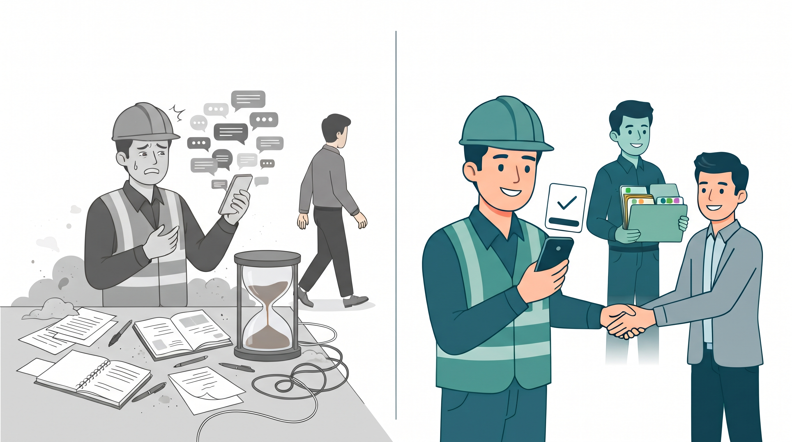

*Nota.* Ilustración generada con Gemini (Google) a partir de una descripción de los autores. No representa a personas reales ni resultados medidos.

### Línea base

La línea base de las metas M1 a M5 se calcula con documentos de la empresa (fechas y horas de las solicitudes de los últimos tres meses, sin datos de clientes) y con los casos de prueba del equipo [FALTA-DATO: línea base M1 y M3, muestra documental de Torvesa] [FALTA-DATO: línea base M2 y M4, casos de prueba CP-01 y CP-02]. [DECIDIR-TUTORA: la forma de medir depende de la propuesta de no recoger datos de personas (véase el capítulo III)]

### Contexto del sector entre 2023 y 2026

La construcción ecuatoriana cayó dos años seguidos y volvió a crecer en 2025 (Tabla 3). En 2025 representó el 4,1 % del PIB (Banco Central del Ecuador, 2026a, p. 22) y el 6,4 % del empleo del país (Banco Central del Ecuador, 2026a, p. 45).

**Tabla 3.** *Crecimiento anual de la construcción y del PIB del Ecuador, 2022–2025*

| Año | Construcción | PIB |
|---|---|---|
| 2022 | +7,5 % | +5,9 % |
| 2023 | −1,7 % | +1,8 % |
| 2024 | −7,9 % | −1,9 % (provisional) |
| 2025 | +2,7 % | +3,7 % (preliminar) |

*Nota.* Banco Central del Ecuador (2026a, p. 22).

Tres hechos del período condicionan el diseño. Primero, la crisis eléctrica de 2024: hubo cortes de luz de hasta 12 horas diarias en algunos sectores (Tapia, 2024) y, según el Banco Central, las pérdidas llegaron a USD 1.916 millones (Redacción Primicias, 2025). Por eso el diseño exige que las fichas de los clientes se puedan consultar sin conexión (RQ-14). Segundo, el cliente ya está en línea: a finales de 2025, el 83,9 % de la población usaba internet (Kemp, 2026). Tercero, las mipymes ecuatorianas usan poco la inteligencia artificial, y una de sus barreras es la falta de bases de datos estructuradas (Pérez-Campdesuñer et al., 2025); además, el 70 % de las organizaciones del país no tiene reglas internas para su uso (Revelo, 2026). De ahí que el primer paso del diseño sea ordenar la memoria comercial de la empresa, con reglas de protección de datos, antes de añadir el asistente. [FALTA-FUENTE: cifra nacional de uso de WhatsApp en los negocios]

La referencia más cercana a Torvesa en las cifras oficiales es la de las compañías pequeñas de construcción de edificios de Pichincha (código F41 de la {+Clasificación Industrial Internacional Uniforme [CIIU]+}, ventas de USD 100.001 a 1.000.000): fueron 273 en 2023, 306 en 2024 y 321 en 2025, con una mediana de cuatro empleados y un margen neto mediano de 1,4 %, 1,7 % y 1,9 % (Superintendencia de Compañías, Valores y Seguros [SCVS], 2026a). Torvesa no está en ese registro: no figura como compañía en la Superintendencia (SCVS, 2026b) y el SRI la registra con la actividad de construcción de carreteras (código F4210) (Servicio de Rentas Internas [SRI], 2026). Por eso esas cifras se usan solo como referencia de una constructora pequeña típica, no como datos de la empresa. [FALTA-DATO: confirmar con Torvesa su actividad real, su tipo de sociedad y si sus clientes son sobre todo privados o públicos]

### Análisis FODA de la propuesta

{+El análisis de fortalezas, oportunidades, debilidades y amenazas (FODA) de la Figura 3+} evalúa la propuesta, no a la empresa entera. Las fortalezas y las debilidades salen de la prueba de concepto {+(la primera versión funcional del sistema, probada con datos ficticios)+} y de la revisión del código; las oportunidades y las amenazas, del contexto anterior.

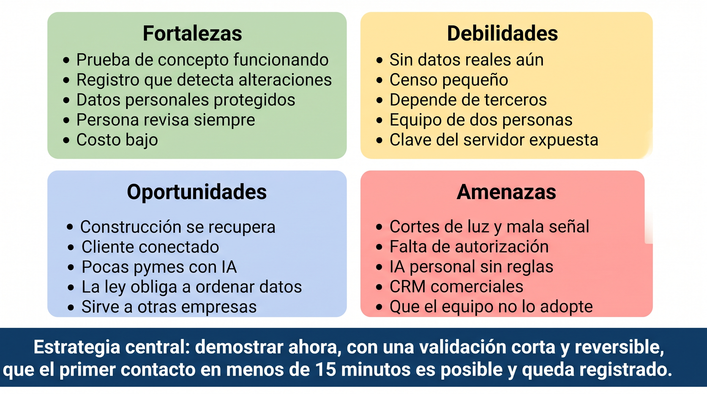

*Nota.* Elaboración propia. La imagen se compuso con Gemini (Google) a partir del texto de los autores, que se revisó palabra por palabra. La prueba de concepto usa solo datos ficticios.

De cruzar los cuatro cuadrantes salen las estrategias de la Tabla 4. La estrategia central es demostrar, con una validación corta y reversible, que el primer contacto en menos de 15 minutos es posible y queda registrado.

**Tabla 4.** *Estrategias que resultan del análisis FODA*

| Tipo | Estrategia |
|---|---|
| Fortalezas y oportunidades | Presentar a la gerencia la prueba de concepto en funcionamiento, mientras la demanda del sector se recupera |
| Fortalezas y oportunidades | Presentar el cumplimiento de la LOPDP como un beneficio del sistema |
| Debilidades y oportunidades | Pedir a la empresa solo las fechas y horas de las solicitudes de tres meses, sin datos de clientes, para calcular la línea base |
| Debilidades y oportunidades | Separar las claves de acceso del servidor antes de usar datos reales |
| Fortalezas y amenazas | Fichas consultables sin conexión, para trabajar con cortes de luz o mala señal |
| Fortalezas y amenazas | Proponer una validación de dos semanas que no compromete a la empresa |
| Debilidades y amenazas | Empezar con lo mínimo que el equipo usa: el aviso de texto y el botón "Tomar" |
| Debilidades y amenazas | Dejar manuales y la bóveda documentada, para que el sistema no dependa de los autores |

*Nota.* Elaboración propia.

## Diseño del sistema

### Requisitos

Los requisitos se obtuvieron con un proceso de elicitación y análisis basado en la norma ISO/IEC/IEEE 29148 y en la {+Guía del Cuerpo de Conocimiento de la Ingeniería de Software (SWEBOK)+} [FALTA-DATO: ficha de la norma ISO/IEC/IEEE 29148 y de SWEBOK en la base de fuentes]. La primera iteración partió de los documentos del proyecto integrador y del código de TEAMSLASH, revisado el 2 de noviembre de 2026. Cada requisito tiene un identificador, la necesidad de la que sale, un criterio de aceptación y la forma de verificarlo. La Tabla 5 resume los 24 requisitos; la versión completa, con su trazabilidad, va en el Anexo 2.

**Tabla 5.** *Requisitos del sistema*

| Código | Requisito (resumen) | Tipo | Meta |
|---|---|---|---|
| RQ-01 | Registrar cada solicitud del formulario con fecha y hora de ingreso en 5 segundos o menos | Funcional | M1 |
| RQ-02 | Enviar una alerta al celular del responsable en 5 segundos o menos, con enlace a la ficha del cliente | Funcional | M1 |
| RQ-03 | Registrar desde el celular una solicitud recibida por WhatsApp o por teléfono, con la hora real de llegada | Funcional | M1, M3 |
| RQ-04 | Asignar cada solicitud a un único responsable y registrar la asignación | Funcional | M1 |
| RQ-05 | Registrar el estado de cada solicitud: Nueva, En contacto, Cotizada, Ganada o Perdida | Funcional | M1, M3 |
| RQ-06 | A los 15 minutos sin primer contacto, recordar al responsable y avisar a la gerencia | Funcional | M1, M3 |
| RQ-07 | Exigir un motivo de una lista cerrada al marcar una solicitud como Perdida | Funcional | M3 |
| RQ-08 | Generar cada lunes un reporte con la mediana del tiempo de primer contacto, los estados y los motivos de pérdida | Funcional | M1, M3 |
| RQ-09 | Mantener en la bóveda una ficha por cliente, con código, y su historial de solicitudes y cotizaciones | Funcional | M4 |
| RQ-10 | Mantener en la bóveda plantillas de cotización por tipo de obra | Funcional | M2 |
| RQ-11 | Generar con el asistente un borrador de respuesta o de cotización e indicar qué documentos usó | Funcional | M2 |
| RQ-12 | Exigir la revisión y la aprobación de una persona antes de enviar cualquier borrador al cliente | No funcional | M2 |
| RQ-13 | Buscar un cliente por código, nombre o tipo de obra y mostrar su historial completo | Funcional | M4 |
| RQ-14 | Mostrar sin conexión las fichas ya sincronizadas en el celular | No funcional | M4 |
| RQ-15 | Guardar cada evento en un registro de solo agregar, con su huella SHA-256 y la del evento anterior | Funcional | M5 |
| RQ-16 | Verificar la integridad del registro y señalar cada evento alterado | Funcional | M5 |
| RQ-17 | Guardar en el registro verificable solo huellas y códigos, sin datos personales | Normativo | — |
| RQ-18 | Pedir en el formulario el consentimiento del prospecto, con enlace al aviso de privacidad | Normativo | — |
| RQ-19 | Eliminar o anonimizar los datos de los prospectos perdidos al cumplirse el plazo de conservación | Normativo | — |
| RQ-20 | Dar acceso solo a cuentas individuales autorizadas por la gerencia | No funcional | — |
| RQ-21 | Enviar al servicio de IA solo códigos de cliente, nunca nombres, teléfonos ni correos | Normativo | — |
| RQ-22 | Alcanzar una usabilidad aceptable al final de la validación | No funcional | M6 |
| RQ-23 | Validar el diseño en operación experimental controlada durante dos semanas | De proyecto | — |
| RQ-24 | Guardar la hora del primer contacto de cada solicitud | Funcional | M1 |

*Nota.* Elaboración propia a partir del documento de elicitación y análisis de requerimientos, versión 0.1 (27 de octubre de 2026), con la revisión técnica del 2 de noviembre de 2026. RQ-22 cambia si se acepta la propuesta de medir la usabilidad sin cuestionarios (capítulo III).

La priorización combinó el valor para el negocio, la urgencia, el costo y el riesgo de cada requisito. Quedaron con prioridad alta el registro de la solicitud, la alerta, el registro manual de lo que llega por WhatsApp, el responsable único, los estados, la revisión humana de los borradores y los tres requisitos de protección de datos (RQ-17, RQ-18 y RQ-21). El borrador con IA (RQ-11) y el registro de solo agregar (RQ-15) quedaron con prioridad baja por su costo y su riesgo técnico, aunque son parte del aporte del proyecto; por eso se acotan: el asistente solo propone borradores que una persona revisa (RQ-12).

{+**Priorización de los requisitos clave.** Diez de los 24 requisitos, los que sostienen las metas M1, M2 y M4, se priorizaron otra vez con tres técnicas: MoSCoW, que separa lo imprescindible (Must) de lo deseable (Should), lo opcional (Could) y lo que no entra en esta entrega (Won't); la matriz valor contra esfuerzo, que cruza lo que aporta cada requisito con las horas que cuesta; y el modelo de Kano (Kano et al., 1984), que pregunta al usuario cómo se sentiría si la función está y si falta. En la primera ronda nueve de los diez quedaron como imprescindibles y sumaban el 81,5 % del esfuerzo estimado, muy por encima del 60 % que recomienda el Agile Business Consortium (s. f.) para que el equipo tenga margen. Con el ajuste quedan como imprescindibles solo el registro de la solicitud (RQ-01), la alerta (RQ-02), la toma de la solicitud con la hora del primer contacto (RQ-04 y RQ-24) y el consentimiento (RQ-18), que suman 30 de 130 horas (23,1 %). El recordatorio (RQ-06), el historial (RQ-09 y RQ-13) y las cuentas individuales (RQ-20) pasan a deseables, el borrador con IA (RQ-10 a RQ-12) y el envío sin datos personales al servicio de IA (RQ-21) se hacen juntos después, y la consulta sin conexión (RQ-14) queda fuera de esta entrega. La prioridad final queda en cuatro requisitos altos, cinco medios y uno bajo.+}

{+Como ejercicio exploratorio, el modelo de Kano se aplicó con un formulario a siete personas de otras empresas que atienden clientes o compran, ninguna de Torvesa. El recordatorio salió atractivo y el borrador con IA, obligatorio, pero la mayoría de funciones salió indiferente con una importancia media de 4,0 a 4,7 sobre 5, lo que sugiere que la opción "lo espero" se entendió como un deseo. [DECIDIR-TUTORA: si este ejercicio, hecho fuera de Torvesa para la asignatura de Ingeniería de Requerimientos, se cita como antecedente exploratorio o se deja fuera por la DEC-21] Con la lista priorizada se armó un backlog, es decir, la lista ordenada del trabajo por hacer, con ocho historias de usuario (cada una describe una función desde el punto de vista de quien la usa), una historia técnica (responder al formulario sin esperar las alertas) y una investigación corta (medir el tiempo de la alerta en el servidor real), repartido en dos sprints de dos semanas. El borrador con IA queda para un tercer sprint (Anexo 10).+}

### Casos de uso y modelo conceptual

La Figura 4 muestra los 12 casos de uso del sistema y sus actores: el prospecto o cliente, el coordinador comercial, quien cotiza, los colaboradores, la gerencia y tres sistemas externos (el canal de alertas, el servicio de IA y el reloj del sistema). Cada caso de uso tiene un escenario operacional y está ligado a sus requisitos.

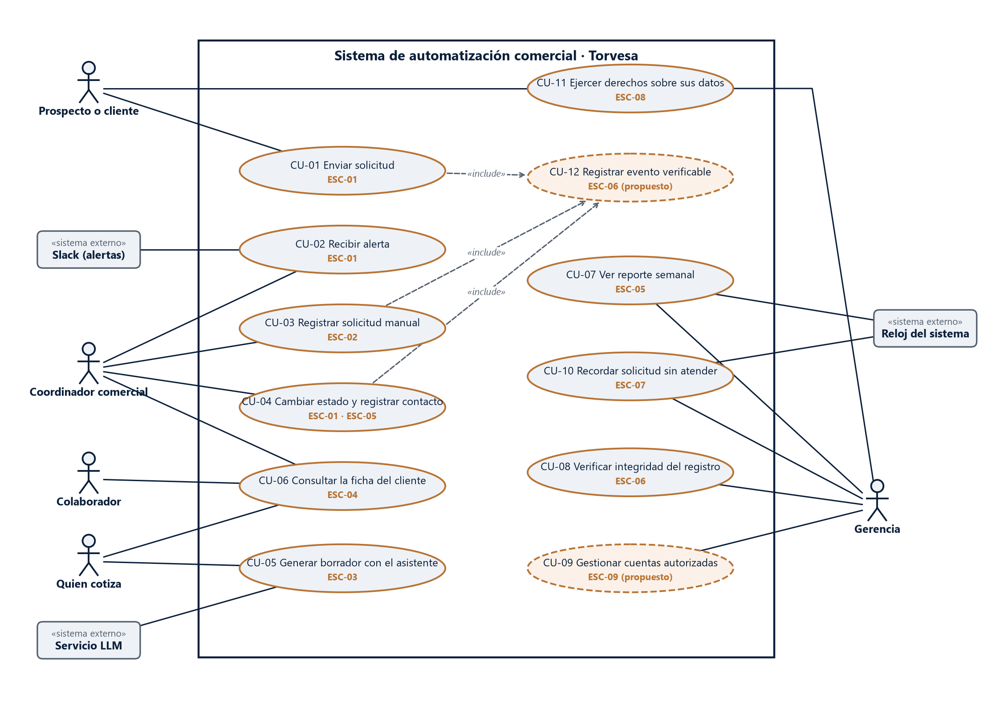

*Nota.* Elaboración propia. CU-12 (registrar evento verificable) se incluye en todos los casos que cambian algo en el sistema.

El modelo conceptual (Figura 5) muestra la información que el sistema debe conservar y cómo se relaciona. Tres decisiones de diseño se ven en él. Primero, los datos personales viven en un solo lugar, la ficha de contacto del cliente; el resto de registros nombra al cliente solo por su código, de modo que se puede borrar a un cliente sin romper la cadena de huellas. Segundo, la asignación y los cambios de estado se guardan como registros propios, porque TEAMSLASH solo conserva el estado actual y, sin historial, no se puede medir el tiempo de primer contacto. Tercero, cada cotización guarda la huella del documento enviado y los documentos que usó el asistente.

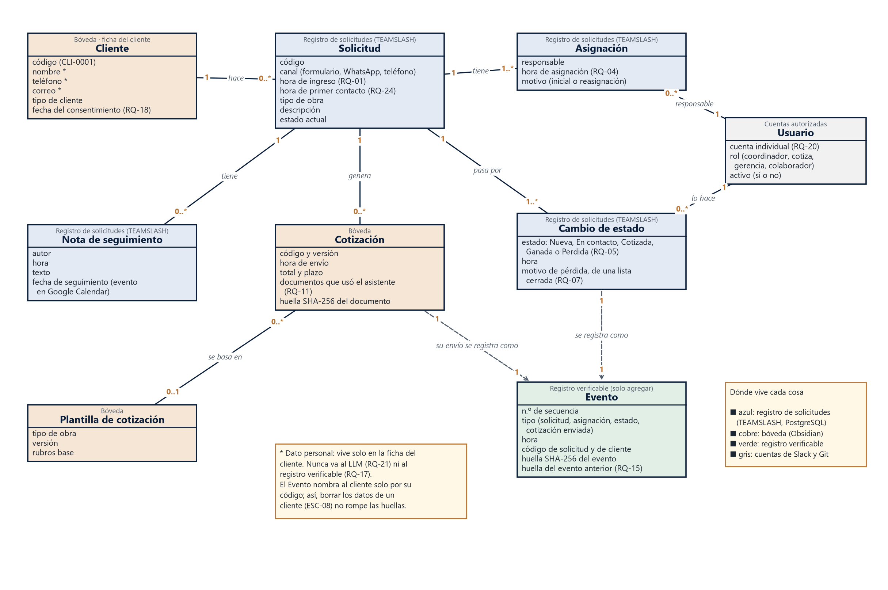

*Nota.* Elaboración propia. Los colores indican dónde vive cada dato: registro de solicitudes (TEAMSLASH), bóveda (Obsidian), registro verificable y cuentas.

### Proceso con el sistema (TO-BE)

El proceso con el sistema se dibujó en BPMN en tres partes, con seis pasos (P1 a P6) y un responsable y un disparador para cada tarea.

La primera parte (Figura 6) cubre la recepción, la asignación, el aviso y el primer contacto. La solicitud entra por el formulario web, con el consentimiento del cliente, o la registra el coordinador desde el celular si llegó por WhatsApp o por teléfono. El sistema le asigna un código, crea o actualiza la ficha del cliente en la bóveda, designa a un único responsable y le envía una alerta con un enlace a esa ficha. Cuando el responsable contacta al cliente y marca "En contacto", el sistema guarda la hora del primer contacto, que es el dato con el que se mide M1.

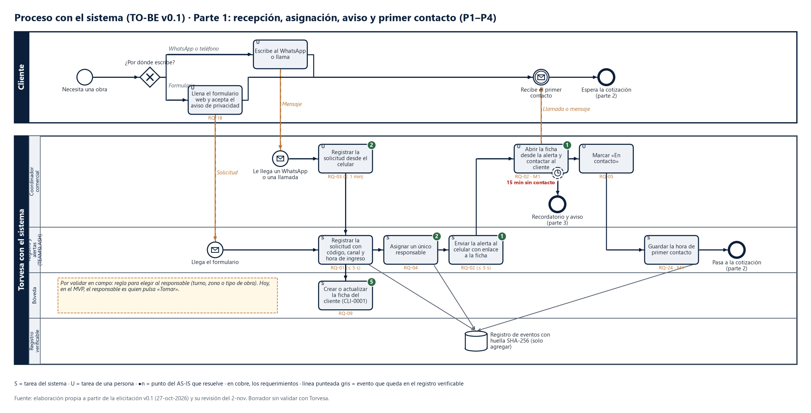

*Nota.* Elaboración propia.

La segunda parte (Figura 7) cubre la cotización asistida y el traspaso del cliente. Quien cotiza pide un borrador desde la ficha; el asistente busca la plantilla del tipo de obra y las cotizaciones anteriores, propone el borrador y cita los documentos que usó. Una persona revisa rubros, precios y plazos antes de enviarlo; el sistema nunca envía nada por sí solo. Al enviarla, se guarda la huella del documento y la solicitud pasa a "Cotizada". Si un cliente llama y su vendedor no está, otra persona busca la ficha y lo atiende sin pedirle que repita su historia.

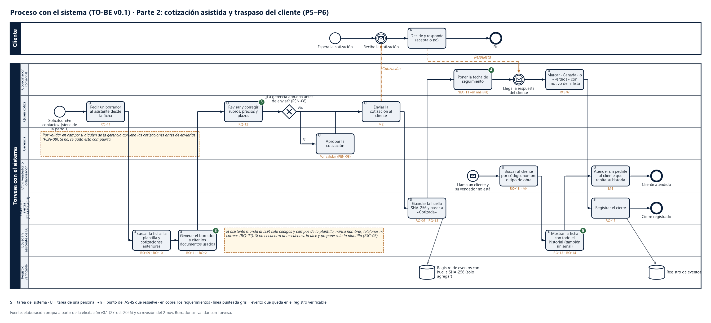

*Nota.* Elaboración propia. La aprobación de la gerencia antes del envío está dibujada como opcional hasta confirmar si existe en la empresa [FALTA-DATO: si la gerencia aprueba las cotizaciones antes de enviarlas].

La tercera parte (Figura 8) reúne tres flujos que arrancan solos, por tiempo o por un hecho: el recordatorio a los 15 minutos sin primer contacto, con aviso a la gerencia y reasignación si sigue sin atenderse; el recordatorio de seguimiento después de cotizar; y la reasignación de las solicitudes abiertas cuando un vendedor deja la empresa, cuyas fichas permanecen en la bóveda.

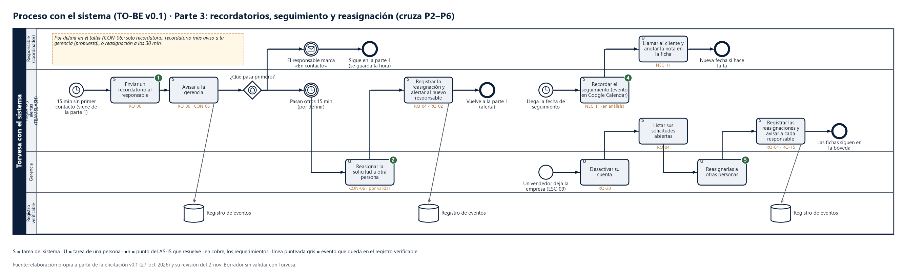

*Nota.* Elaboración propia. El segundo plazo de 15 minutos para la reasignación es un supuesto por validar con la empresa.

### Trazabilidad entre los requisitos y el proceso con el sistema

Para comprobar que el proceso con el sistema cubre lo que piden los requisitos, cada uno de los 24 se buscó en las tareas de las tres partes del TO-BE (Tabla 6). El resultado tiene tres partes: 19 requisitos aparecen en el flujo de atención o en las reglas de datos; 3 pertenecen a procesos de la gerencia que tienen caso de uso pero no diagrama (el reporte semanal, la verificación de integridad y la eliminación de datos); y 2 no son pasos de un flujo, porque se refieren a la usabilidad y a la propia validación.

**Tabla 6.** *Trazabilidad de los requisitos frente al proceso con el sistema (TO-BE)*

| Requisito | Dónde aparece en el TO-BE | Estado |
|---|---|---|
| RQ-01 Registrar la solicitud con fecha y hora | Parte 1, tarea 3 | Cubierto |
| RQ-02 Alerta al responsable | Parte 1, tareas 6 y 7; parte 3, tarea 5 | Cubierto |
| RQ-03 Registrar desde el celular lo que llega por WhatsApp o teléfono | Parte 1, tarea 2 | Cubierto |
| RQ-04 Responsable único | Parte 1, tarea 5; parte 3, tareas 5, 9, 10 y 11 | Cubierto |
| RQ-05 Estados de la solicitud | Parte 1, tarea 8; parte 2, tareas 7 y 9 | Cubierto |
| RQ-06 Recordatorio a los 15 minutos y aviso a la gerencia | Parte 3, tareas 1 y 2 | Cubierto |
| RQ-07 Motivo obligatorio al perder | Parte 2, tarea 9 | Cubierto |
| RQ-08 Reporte de cada lunes | Caso de uso CU-07, sin diagrama | Hueco: falta dibujarlo |
| RQ-09 Ficha del cliente en la bóveda | Parte 1, tarea 4; parte 2, tarea 2 | Cubierto |
| RQ-10 Plantillas por tipo de obra | Parte 2, tarea 2 | Cubierto |
| RQ-11 Borrador del asistente con sus documentos | Parte 2, tareas 1 y 3 | Cubierto |
| RQ-12 Revisión humana antes de enviar | Parte 2, tareas 4 y 6 | Cubierto |
| RQ-13 Buscar al cliente y ver su historial | Parte 2, tareas 10 y 11 | Cubierto |
| RQ-14 Fichas sin conexión | Parte 2, tarea 11 | Cubierto |
| RQ-15 Registro de solo agregar con huellas | Columna "evento que se registra" de todas las tareas; parte 2, tarea 7; parte 3, tarea 11 | Cubierto |
| RQ-16 Verificar la integridad del registro | Caso de uso CU-08, sin diagrama | Hueco: falta dibujarlo |
| RQ-17 Solo huellas y códigos en el registro | Regla del modelo conceptual (Figura 5) | Cubierto como regla de datos |
| RQ-18 Consentimiento en el formulario | Parte 1, tarea 1 | Cubierto |
| RQ-19 Eliminar o anonimizar al vencer el plazo | Caso de uso CU-11, sin diagrama | Hueco: falta dibujarlo |
| RQ-20 Cuentas individuales autorizadas | Parte 3, tarea 8 | Cubierto |
| RQ-21 Solo códigos al servicio de IA | Parte 2, tarea 3 | Cubierto |
| RQ-22 Usabilidad aceptable | No es un paso del flujo: se mide en la evaluación (M6) | No aplica |
| RQ-23 Validación de dos semanas | No es un paso del flujo: es el protocolo de la validación | No aplica |
| RQ-24 Hora del primer contacto | Parte 1, tarea 9 | Cubierto |

*Nota.* Elaboración propia a partir de las tablas de pasos de las tres partes del TO-BE (4 de noviembre de 2026) y de los casos de uso (31 de octubre de 2026).

La revisión también encontró lo contrario: tareas del TO-BE que no tienen un requisito. La fecha de seguimiento y su recordatorio (parte 2, tarea 8, y parte 3, tareas 6 y 7) responden al punto crítico "seguimiento de memoria", pero solo tienen una necesidad en análisis; la aprobación de la gerencia antes de enviar una cotización (parte 2, tarea 5) depende de si esa práctica existe en la empresa; y la reasignación automática después de un segundo plazo de 15 minutos (parte 3, tarea 4) es un supuesto por validar. [DECIDIR-VÍCTOR: agregar un requisito RQ-25 para la fecha de seguimiento con recordatorio] [FALTA-DATO: si la gerencia aprueba las cotizaciones antes de enviarlas]

### Proceso central y escalabilidad

De los cinco puntos críticos, la espera y la asignación informal forman el proceso central del diseño: son los que más afectan a la empresa hoy, se pueden medir con las horas que guarda el sistema y ya funcionan en la prueba de concepto. Este proceso, el primer contacto en menos de 15 minutos con responsable y registro, tiene ocho pasos (Tabla 7 y Figura 9). [DECIDIR-VÍCTOR: nombre del proceso; se propone "Primer contacto garantizado"]

**Tabla 7.** *Pasos del proceso central*

| Paso | Qué pasa | Quién | Tiempo objetivo |
|---|---|---|---|
| 1. Captura | La solicitud entra por el formulario, con consentimiento, o se registra desde el celular si llegó por WhatsApp o teléfono | Cliente o coordinador | Al llegar |
| 2. Código y registro | El sistema le da un código y guarda la hora de llegada en el registro con huellas | Sistema | 5 segundos o menos |
| 3. Aviso | Llega una tarjeta al celular del equipo, con un enlace a la ficha | Sistema | 5 segundos o menos |
| 4. Tomar | Alguien pulsa "Tomar" y queda como único responsable | Responsable | Antes del minuto 15 |
| 5. Primer contacto | El responsable contacta al cliente y el sistema guarda la hora | Responsable | Antes del minuto 15 |
| 6. Escalamiento | Si nadie tomó la solicitud, se recuerda al equipo y se avisa a la gerencia | Sistema | Minuto 15 |
| 7. Cierre con motivo | Si el cliente se pierde, el motivo es obligatorio | Responsable | Al cerrar |
| 8. Reporte semanal | Tiempo de primer contacto, estados, motivos de pérdida y la última huella del registro | Sistema | Cada lunes |

*Nota.* Elaboración propia. Los tiempos son objetivos de diseño; se medirán en la validación.

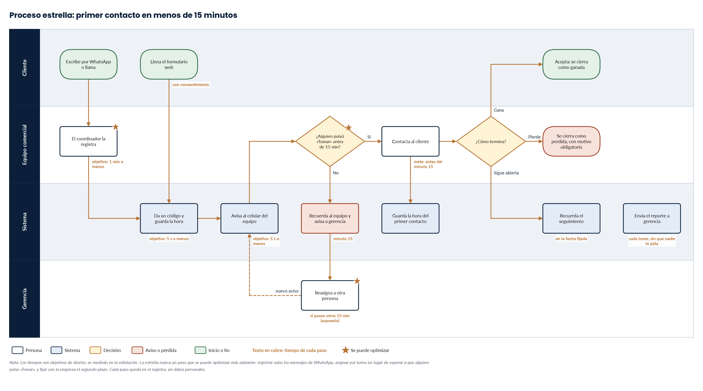

*Nota.* Elaboración propia.

El diseño se organiza en tres niveles, y cada uno necesita el anterior (Tabla 8). El primero sirve a cualquier empresa que recibe solicitudes de clientes y cuyo personal trabaja fuera de la oficina; lo que cambia de una empresa a otra es la configuración (tipos de trabajo, plantillas, plazo objetivo y canales), no el núcleo. Cada empresa tendría su propia base de datos y su propia bóveda, de modo que los datos de clientes de dos empresas nunca se mezclan.

**Tabla 8.** *Niveles del diseño y posibilidad de aplicarlo en otras empresas*

| Nivel | Qué incluye | A quién le sirve |
|---|---|---|
| 1. Primer contacto con responsable y registro | Captura, aviso, responsable único, recordatorio a los 15 minutos, motivo de pérdida, reporte semanal y registro con huellas | Constructoras, empresas de remodelación, inmobiliarias y proveedores de materiales |
| 2. Memoria comercial | Bóveda con la ficha y el historial de cada cliente, plantillas y consulta sin conexión | Empresas con rotación de personal o con varios vendedores; exige ordenar antes sus datos |
| 3. Cotización asistida | Borrador de cotización con el asistente, sin precios, con los documentos citados y revisado por una persona | Empresas que cotizan trabajos parecidos con frecuencia |

*Nota.* Elaboración propia. La aplicación en otras empresas es una proyección del diseño; este trabajo solo lo evalúa en Torvesa.

El proceso central se controla con indicadores que el propio sistema calcula (Tabla 9). [FALTA-FUENTE: normas ISO/IEC 25010 e ISO 9001, que se usarán solo como marco para ordenar los indicadores, sin certificación]

**Tabla 9.** *Indicadores del proceso central*

| Indicador | Cómo se calcula | Meta |
|---|---|---|
| Tiempo de primer contacto | Mediana de la hora del primer contacto menos la hora de llegada | Menos de 15 minutos (M1) |
| Solicitudes atendidas dentro del plazo | Atendidas antes del plazo entre el total | [DECIDIR-VÍCTOR: meta; se propone 80 % o más] |
| Solicitudes con responsable | Con responsable entre el total | 100 % |
| Pérdidas con motivo | Perdidas con motivo entre el total de perdidas | 100 % (M3) |
| Alteraciones detectadas | Detectadas entre las simuladas | 100 % (M5) |
| Datos personales enviados al asistente | Solicitudes con datos personales en lo enviado entre el total | 0 % |

*Nota.* Elaboración propia.

### Componentes del sistema

La Figura 10 muestra cómo se conectan los componentes. El registro de solicitudes es TEAMSLASH, que ya existe: un formulario web, una API propia y una base de datos PostgreSQL, con alertas por Slack (Bermeo y Segura, 2026, p. 5). Sobre él se diseñan tres componentes nuevos: la bóveda de conocimiento comercial, el asistente de IA y el registro verificable.

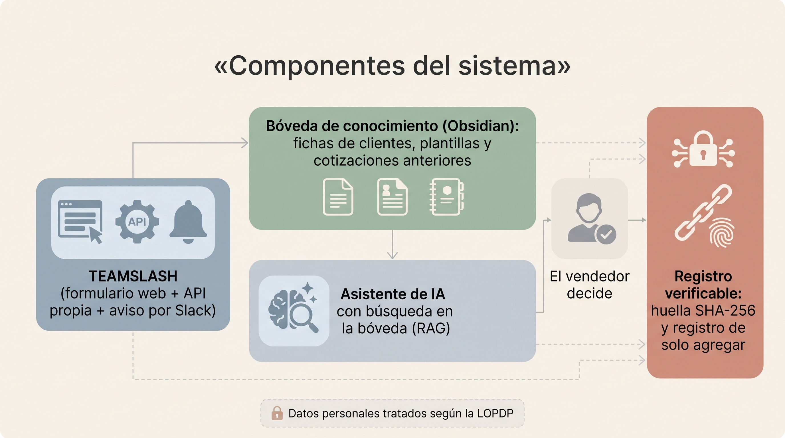

*Nota.* Elaboración propia.

La revisión técnica de TEAMSLASH del 2 de noviembre de 2026 mostró qué parte del diseño ya existía y qué era nuevo. El 8 de noviembre el sistema volvió a estar en línea y la prueba de concepto recorrió el flujo completo con datos ficticios (Figura 11). La Tabla 10 resume el estado de cada función.

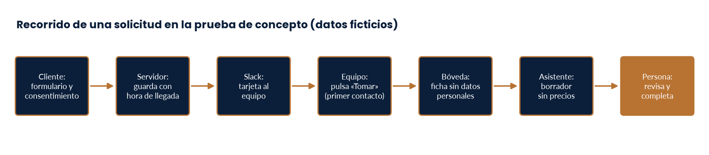

*Nota.* Elaboración propia. Slack es el servicio de mensajería por el que el equipo recibe los avisos. Todas las solicitudes de la prueba son ficticias.

**Tabla 10.** *Funciones de TEAMSLASH y estado de las funciones nuevas al 8 de noviembre de 2026*

| Función | Estado |
|---|---|
| Formulario web que registra la solicitud con un código de cliente | Ya existía |
| Aviso al equipo con botones de estado; quien pulsa "Tomar" queda como responsable | Ya existía |
| Notas con autor y fecha, y fecha de seguimiento en el calendario | Ya existía |
| Casilla de consentimiento obligatoria en el formulario (RQ-18) | Nueva; funciona en la prueba de concepto |
| Hora del primer contacto (RQ-24) | Nueva; funciona en la prueba de concepto |
| Registro verificable con huellas SHA-256 encadenadas (RQ-15 a RQ-17) | Nueva; funciona. En una primera prueba detectó tres de tres alteraciones |
| Bóveda, plantillas de cotización y asistente (RQ-09 a RQ-12 y RQ-21) | Nuevas; funcionan como prueba de concepto |
| Cinco estados, motivo de pérdida obligatorio, recordatorio a los 15 minutos y reporte semanal (RQ-05 a RQ-08) | Programadas; falta publicarlas y probarlas [FALTA-DATO: versión publicada, por confirmar con el servidor] |

*Nota.* Elaboración propia a partir de la revisión del código (2 y 10 de noviembre de 2026) y del reporte de la prueba de concepto (8 de noviembre de 2026).

### La bóveda de conocimiento comercial

La bóveda es una carpeta de notas en Obsidian que guarda la memoria comercial de la empresa, de modo que ya no dependa del celular de cada vendedor. Su versión 0.1, con datos ficticios, tiene la estructura de la Tabla 11.

**Tabla 11.** *Estructura de la bóveda de conocimiento comercial*

| Carpeta | Qué guarda | Requisito |
|---|---|---|
| Clientes | Una ficha por cliente, identificada con un código y sin datos personales | RQ-09 |
| Solicitudes | Estado, responsable, hora de ingreso y hora de primer contacto | RQ-05, RQ-24 |
| Cotizaciones | Cada cotización enviada, los documentos que usó el asistente y su huella | RQ-11, RQ-15 |
| Plantillas de cotización | Una por tipo de obra, con los rubros y sin precios | RQ-10 |
| Equipo | Una nota por vendedor, con su rol y si está activo | RQ-20 |
| Contactos | Nombre, teléfono y correo: lo único con datos personales; el asistente no la lee | RQ-19, RQ-21 |
| Tableros | Pendientes por vendedor, clientes por responsable y cotizaciones que esperan respuesta | RQ-08 |

*Nota.* Elaboración propia. Los tableros usan la función Bases, incluida en Obsidian, sin complementos adicionales.

Como Obsidian no permite dar permisos distintos a cada usuario dentro de una misma bóveda (Obsidian, s. f.), los datos personales se separan en una sola carpeta, que el asistente nunca consulta. [DECIDIR-VÍCTOR: si la carpeta de contactos va en una bóveda aparte, a la que solo accede quien atiende] [DECIDIR-VÍCTOR: sincronización en el celular con el complemento de Git (gratuito, pero inestable en el móvil) o con Obsidian Sync (de pago)]

### Protección de datos personales y cumplimiento de la LOPDP

El sistema trata datos personales de los prospectos y clientes: su nombre, su teléfono, su correo y lo que escriben en la solicitud. Por eso se rige por la Ley Orgánica de Protección de Datos Personales (LOPDP, 2021) y su Reglamento General (Decreto Ejecutivo 904, 2023). Esta sección resume qué obliga la ley y cómo responde el diseño.

**Quién es quién.** Torvesa decide para qué se usan los datos de sus clientes, por lo que, en la operación normal del sistema, sería la responsable del tratamiento. TEAMSLASH, el servicio que prestan los autores, accede a esos datos solo para prestarle el servicio; en ese caso la ley no lo considera una transferencia, sino el acceso de un encargado, y exige un contrato que diga que el encargado tratará los datos solo según las instrucciones del responsable, no los usará para otros fines y los devolverá o destruirá al terminar (LOPDP, 2021, art. 34, pp. 33–34). Durante la validación, la pregunta de quién figura como responsable sigue abierta. [DECIDIR-TUTORA: DEC-20: quién figura como responsable del tratamiento durante la validación (la empresa, los estudiantes o la UPS) y si hace falta la aprobación de un comité de ética]

**Obligaciones y controles.** La Tabla 12 pone frente a frente cada obligación de la ley que toca al sistema y el control del diseño que la cumple.

**Tabla 12.** *Obligaciones de la LOPDP y controles del diseño*

| Obligación | Artículo (página) | Control del diseño | Estado al 16-nov |
|---|---|---|---|
| Tratar los datos con una base legal, como el consentimiento libre, específico, informado e inequívoco | Arts. 7 y 8 (pp. 14–15) | Casilla obligatoria en el formulario, con enlace al aviso de privacidad (RQ-18) | Funciona en la prueba de concepto |
| Informar al titular los fines, la base legal, el tiempo de conservación, el responsable, las transferencias y cómo ejercer sus derechos | Art. 12 (pp. 20–21) | Aviso de privacidad enlazado desde el formulario | Falta el {+registro único de contribuyentes (RUC)+}, el correo de contacto y el plazo de conservación de Torvesa |
| Conservar los datos solo el tiempo necesario | Art. 10, lit. i (p. 18) | Eliminación o anonimización de los prospectos perdidos al vencer el plazo (RQ-19) | Diseñado; falta que la gerencia fije el plazo |
| Atender los derechos de acceso, rectificación y eliminación en 15 días | Arts. 13 a 15 (pp. 21–22) | Los datos personales viven en una sola carpeta; el resto usa códigos, así que se pueden entregar, corregir o borrar sin romper la cadena de huellas (RQ-17, RQ-19) | Diseñado |
| Aplicar medidas de seguridad según el riesgo y evaluarlas de forma continua | Art. 37 (pp. 35–36) | Cuentas individuales (RQ-20), códigos en lugar de nombres, huellas SHA-256 (RQ-15 y RQ-16) y claves del servidor separadas | Parcial: falta separar la clave del servidor |
| Proteger los datos desde el diseño y por defecto: tratar solo los necesarios | Art. 39 (p. 37) | El registro verificable y el asistente solo ven códigos (RQ-17 y RQ-21) | Funciona en la prueba de concepto |
| Analizar los riesgos con una metodología | Arts. 40 y 41 (pp. 37–38) | Matriz de riesgos del proyecto (Anexo 5) | Versión 0.1 |
| Firmar un contrato con el encargado que accede a los datos | Art. 34 (pp. 33–34) | Acuerdo de tratamiento entre Torvesa y TEAMSLASH | Por firmar antes de la validación |
| Notificar una vulneración: el responsable, a la autoridad en 5 días; el encargado, al responsable en 2 días; al titular, en 3 días si hay riesgo | Arts. 43 y 46 (pp. 38–39) | Procedimiento de incidentes en el manual de operación (OE5) | Por escribir |
| Transferir datos a otro país solo con nivel adecuado de protección o garantías | Arts. 55 a 57 (págs. 46–47) | Al servicio de IA del exterior solo se envían códigos, nunca nombres, teléfonos ni correos (RQ-21) | Funciona en la prueba de concepto |

*Nota.* Elaboración propia con la LOPDP (2021); las páginas son las del Registro Oficial, Quinto Suplemento n.º 459.

Dos obligaciones no parecen aplicar al sistema, aunque se revisaron. La evaluación de impacto es obligatoria cuando hay perfiles automatizados que producen efectos jurídicos, datos especiales a gran escala u observación sistemática de lugares públicos (LOPDP, 2021, art. 42, p. 38); el sistema no hace nada de eso, porque el asistente solo propone borradores que una persona revisa (RQ-12). El delegado de protección de datos es obligatorio en el sector público, cuando el volumen o la naturaleza del tratamiento exigen un control permanente, o con datos especiales a gran escala (LOPDP, 2021, art. 48, p. 42); con el volumen de solicitudes de una constructora pequeña no parece necesario, aunque lo precisa el reglamento. [FALTA-FUENTE: artículos del Reglamento General sobre consentimiento, conservación y delegado, con página] [FALTA-DATO: país donde el proveedor del servidor guarda los datos]

Al final, el diseño cumple la ley sobre todo por lo que no guarda: los datos personales están en un solo lugar y todo lo demás (el registro verificable, el asistente, los reportes) trabaja con códigos. Lo que falta antes de usar datos reales no es técnico sino documental: el aviso de privacidad con los datos de la empresa, el plazo de conservación y el contrato con el encargado.

### Herramientas, costos y viabilidad económica

**Aviso sobre las cifras.** Los costos, los precios de los proveedores, las cargas laborales y tributarias, la tasa de descuento y los márgenes del sector salen de fuentes verificadas, consultadas entre el 21 de octubre y el 15 de noviembre de 2026. Los datos de la empresa (solicitudes por mes, clientes perdidos, valor de una obra y sueldos) siguen siendo supuestos del equipo, porque Torvesa aún no entrega su información: de las entradas del modelo que dependen de la empresa, solo el 6 % es un dato. [FALTA-DATO: formularios 101 del SRI de 2023 a 2025, solicitudes por mes, clientes perdidos antes del primer contacto, valor promedio de una obra y tasa de cierre] Los resultados cambian cuando esos datos lleguen.

**Selección de herramientas.** Se compararon once alternativas con nueve criterios ponderados (Tabla 13): el costo total a tres años y la protección de datos pesan 20 % cada uno; la facilidad de adopción, 15 %; el funcionamiento con mala conexión, la integración con WhatsApp y con el servicio de avisos, y la escalabilidad, 10 % cada uno; y la dependencia del proveedor, el registro verificable y el soporte en español, 5 % cada uno. El costo se puntúa con una fórmula y los demás criterios, de 1 a 5, con la evidencia de cada puntaje.

**Tabla 13.** *Resultado de la matriz de decisión de herramientas*

| Puesto | Alternativa | Puntaje (de 5) | Costo total a tres años |
|---|---|---|---|
| 1 | Herramientas de la prueba de concepto (servidor propio, mensajería, Obsidian y asistente por consumo) | 4,14 | USD 9.039 |
| 2 | Las mismas herramientas con otro modelo de IA | 3,99 | USD 9.019 |
| 3 a 6 | CRM comercial (Pipedrive, HubSpot, Zoho u Odoo) más el formulario actual | 3,55 a 3,36 | USD 9.115 a 10.771 |
| 7 | Servicios de Amazon Web Services con búsqueda en documentos gestionada | 3,23 | USD 13.583 |
| 8 | Bitrix24 más el formulario actual | 3,15 | USD 8.959 |
| 9 y 10 | Microsoft Dynamics 365 | 3,09 y 2,99 | USD 21.286 y 29.866 |
| 11 | Amazon Web Services con un modelo propio entrenado | 2,06 | USD 724.428 |

*Nota.* Elaboración propia con la matriz de herramientas versión 0.2 (15 de noviembre de 2026). Los puntajes cualitativos son una valoración del equipo. El costo total incluye supuestos de uso. [DECIDIR-TUTORA: criterios y pesos de la matriz]

Las herramientas de la prueba de concepto obtienen el mayor puntaje con cinco de los seis juegos de pesos que se probaron. Los CRM comerciales cubren el seguimiento de las ventas, pero no la memoria comercial, ni el asistente que cita los documentos de la empresa, ni el registro verificable. Entrenar un modelo propio queda en último lugar por tres razones: la empresa no tiene un historial digitalizado con el cual entrenarlo; mantenerlo en servicio cuesta USD 23,50 por hora (Amazon Web Services [AWS], s. f.-a), unos USD 17.155 al mes; y el propio proveedor recomienda empezar por la búsqueda en los documentos de la empresa cuando las respuestas deben apoyarse en ellos (AWS, s. f.-b), que es lo que exige el diseño (RQ-11). Esa alternativa queda como ruta de crecimiento si el sistema llega a ofrecerse a varias empresas. La versión 0.2 de la matriz sumó dos herramientas que trabajan con WhatsApp: Kommo, que cuesta USD 16,67 por usuario al mes con pago anual (Kommo, s. f.), y Leadsales, cuyo plan avanzado para cinco usuarios cuesta USD 247 al mes (Leadsales, s. f.). Según la comparación del equipo, cubren mejor la conversación con el cliente, pero tampoco traen la memoria comercial, el borrador que cita los documentos de la empresa ni el registro verificable.

**Cómo se ofrece el sistema.** El sistema se analiza como un servicio que TEAMSLASH, formado por los autores, presta a un solo cliente, Torvesa, en dos planes. El plan Estándar incluye el primer contacto con responsable y registro y la memoria comercial (bóveda); el Premium añade el asistente de IA para los borradores de cotización. Para Torvesa, la mensualidad es gasto de operación, porque paga por el acceso y no adquiere un activo (IFRS Interpretations Committee, 2021). El modelo financiero sigue la estructura de un estudio financiero de proyectos (inversión, costos, precio, ingresos, estado de resultados, flujo de caja y evaluación), cubre tres años y tres escenarios, y va completo en el Anexo 5.

**Formación del precio.** La hora de trabajo de los autores no se supuso: se calculó con el salario que pretende un desarrollador semi-senior en Ecuador, USD 1.084 al mes (Ekos Negocios, 2025), más las cargas que paga un empleador: el aporte patronal de 12,15 %, que suma el 11,15 % del seguro social (Instituto Ecuatoriano de Seguridad Social [IESS], 2014, p. 1) y un punto para la capacitación (González, 2026b), los décimos, las vacaciones y los fondos de reserva (Código del Trabajo, 2005). El resultado es USD 9,26 por hora. Las horas que los autores ya invirtieron en el levantamiento del sistema, 200 según el supuesto del modelo [FALTA-DATO: horas reales del levantamiento, del registro de contribuciones y del historial de cambios], valen USD 1.852; se tratan como un aporte de los socios que el plan Premium devuelve en 36 meses. Sobre el costo se suma un margen de 20 % (Tabla 14). {+(decisión del equipo del 20 de noviembre de 2026)+}

**Tabla 14.** *Formación del precio mensual de cada plan, en dólares*

| Concepto | Estándar | Premium |
|---|---|---|
| Servicios en la nube (servidor, página, bóveda, mensajería e IA), con IVA | 80,50 | 82,74 |
| Mantenimiento (4 y 7 horas al mes, a USD 9,26 la hora) | 37,04 | 64,82 |
| Recuperación del levantamiento (USD 1.852 en 36 meses) | — | 51,44 |
| Gastos administrativos (firmas, dominio y herramienta de programación) | 26,84 | 26,84 |
| Costo total | 144,38 | 225,84 |
| Margen de 20 % | 28,88 | 45,17 |
| Precio al mes, sin IVA, redondeado a USD 5 | 175 | 275 |
| Implementación (pago único) | 222 | 311 |

*Nota.* Elaboración propia con el modelo financiero del Anexo 5, escenario base. El impuesto al valor agregado de los servicios digitales del exterior se causa al momento del pago (Servicio de Rentas Internas [SRI], 2021, p. 1); el modelo usa la tarifa del 15 % [VERIFICAR-PÁG: tarifa vigente, Decreto Ejecutivo 198].

El precio es alto frente a la competencia: el Estándar cuesta 1,7 veces y el Premium 2,7 veces el promedio de seis herramientas comerciales, porque ellas reparten sus costos entre miles de clientes y aquí hay uno solo. Si el servicio llegara a 20 empresas, el costo por empresa bajaría a unos USD 59 al mes (Anexo 6).

**Resultados para Torvesa.** Con el plan Premium, el escenario base da a Torvesa un valor actual neto de USD 13.618 en tres años, y la empresa recupera lo que paga al inicio (la implementación y las horas de capacitación de su equipo) en menos de un mes (Tabla 15). El beneficio del escenario base es de unos USD 892 al mes: USD 535 por el margen de las obras que se dejan de perder y USD 357 por el tiempo que se libera. La lectura más útil para la gerencia es el umbral: el sistema se paga si recupera 1,9 obras al año que hoy se pierden, aunque no ahorre ni un minuto.

**Tabla 15.** *Resultados para Torvesa a tres años con el plan Premium, por escenario*

| Indicador | Pesimista | Base | Optimista |
|---|---|---|---|
| Margen de una obra que usa el modelo | 2,35 % (neto) | 11,88 % (bruto) | 24,40 % (bruto, vivienda) |
| Tasa de descuento | 17,18 % | 15 % | 9,87 % |
| Beneficio para Torvesa al mes | USD 52 | USD 892 | USD 4.224 |
| Valor actual neto para Torvesa | −USD 9.504 | USD 13.618 | USD 112.143 |
| Obras al año que pagan el sistema | 24,9 | 1,9 | 0,6 |

*Nota.* Elaboración propia con el modelo financiero del Anexo 5. Márgenes de constructoras de mercados emergentes (Damodaran, 2026b). Con el plan Estándar, el escenario base da un VAN de USD 13.081 y un umbral de 1,2 obras al año. Los beneficios son supuestos [FALTA-DATO: línea base de M2, M3 y M4].

El escenario pesimista es negativo y se muestra a propósito: si una obra recuperada solo deja el margen neto del sector, harían falta 25 obras al año y el sistema no se paga. El base usa el margen bruto, porque una obra adicional no aumenta los costos fijos de la empresa. El optimista reúne todos los supuestos favorables y no es una proyección esperada. Para dimensionar el costo, en una constructora pequeña típica de Pichincha (ventas anuales de USD 320.229 y margen neto de 1,89 %) el sistema costaría el 1,1 % de las ventas, pero el 56 % de la utilidad neta del año (SCVS, 2026a). Por eso el sistema se justifica por las obras que recupera y no por el tiempo que ahorra.

**Resultados para TEAMSLASH.** Desde el lado de quien presta el servicio, la inversión inicial es de USD 2.243: USD 1.852 en horas ya trabajadas y USD 391 en efectivo. La tasa de descuento del escenario base es de 15 %, la misma del proyecto integrador (Bermeo y Segura, 2026, p. 28); la del pesimista, de 17,18 %, es la prima de riesgo de las acciones de Ecuador (Damodaran, 2026), y la del optimista, de 9,87 %, la tasa activa máxima para pymes (Banco Central del Ecuador, 2026b). [FALTA-FUENTE: tasa libre de riesgo, para completar la tasa del escenario pesimista] La Tabla 16 resume la evaluación.

**Tabla 16.** *Evaluación del servicio para TEAMSLASH con un solo cliente, escenario base*

| Indicador | Estándar | Premium |
|---|---|---|
| Valor actual neto a tres años | −USD 1.153 | USD 427 |
| Tasa interna de retorno | Negativa | 26 % |
| Período de recuperación | Más de tres años | Unos 25 meses |
| Relación beneficio/costo | 0,79 | 1,03 |
| Pago por hora de trabajo de los autores, año 2 | USD 4,05 | USD 14,53 |
| VAN en los escenarios pesimista y optimista | −USD 1.580 y −USD 675 | USD 402 y USD 517 |

*Nota.* Elaboración propia con el modelo financiero del Anexo 5. Antes del impuesto personal de los autores, en dólares de 2026, sin inflación ni valor residual.

Con un solo cliente, solo el plan Premium hace viable el proyecto, y por poco: su relación beneficio/costo es de 1,03, y su VAN es positivo en los tres escenarios. El Estándar cubre la operación, pero no devuelve las horas que los autores ya invirtieron. Para ellos, el Premium deja unos USD 77 al mes a cada uno: un ingreso extra, no un sueldo.

**Qué cambió frente al borrador anterior.** Con los datos verificados, dos cifras del borrador 2 no se sostienen, y se dicen. La tasa de descuento de 12 % del escenario base era baja: la sola prima de riesgo de las acciones de Ecuador es de 17,18 % (Damodaran, 2026), por lo que la base pasó a 15 %. Y un margen de obra de 10 % era alto si se entiende como margen neto: el margen neto mediano de las constructoras pequeñas de Pichincha es de 1,9 % (SCVS, 2026a). Además, el aporte patronal es de 12,15 % y no de 11,15 %, y el análisis cambió de enfoque: antes suponía que Torvesa desarrollaba el sistema por su cuenta (VAN base de USD 11.557); ahora Torvesa contrata el servicio y se evalúan las dos partes.

El crecimiento del servicio a otras empresas, con un techo de 20 (el 6 % de las 321 constructoras pequeñas de Pichincha), va como anexo de contexto (Anexo 6).

### Riesgos del diseño

Los riesgos se calificaron con una matriz de probabilidad por impacto, de 1 a 5 cada uno, en la que el nivel es el producto de los dos: de 15 a 25 es crítico; de 10 a 14, alto; de 5 a 9, medio, y de 1 a 4, bajo. Donde había un dato, la calificación se apoya en él. En Ecuador, el 9,09 % de los adultos cerró un negocio en 2025, y el motivo más citado fue que no era rentable, con el 27,71 % de los cierres (Amaya et al., 2026, pp. 24 y 26). En Estados Unidos, de los negocios abiertos en el año que terminó en marzo de 2021, el 79,1 % seguía abierto al año y el 47,2 % a los cinco años (U.S. Bureau of Labor Statistics, 2026). Y entre las empresas con capital de riesgo que cerraron desde 2023, el 70 % se quedó sin capital y el 43 % no logró que su producto encajara en el mercado (CB Insights, 2026). Por eso el análisis parte de un solo cliente y no de una proyección de ventas.

De los 18 riesgos identificados, siete son críticos hoy (Tabla 17). Con las medidas previstas, ninguno queda crítico y uno queda alto: que Torvesa no autorice a tiempo, que no depende del equipo y es la ruta crítica del proyecto.

**Tabla 17.** *Riesgos críticos del proyecto y su mitigación*

| Riesgo | Nivel hoy | Mitigación | Nivel después |
|---|---|---|---|
| Torvesa no autoriza a tiempo la validación ni el acceso a sus solicitudes | 25, crítico | Casos de prueba con datos ficticios; pedir solo fechas y horas de las solicitudes; plan alterno con fecha límite | 12, alto |
| La clave del servidor está visible en la página pública y permite leer las solicitudes | 25, crítico | Separar una clave para enviar el formulario y otra privada para leer; cambiar la actual antes de usar datos reales | 5, medio |
| Las solicitudes que llegan por WhatsApp no se registran | 16, crítico | Registro manual en un minuto desde el celular (RQ-03) | 9, medio |
| Los datos financieros de Torvesa siguen siendo supuestos | 16, crítico | Pedir los formularios 101 del SRI y una muestra de tres meses de solicitudes | 6, medio |
| La tutora no aprueba medir sin datos de personas | 15, crítico | Llevar la propuesta por escrito en el borrador y pedir la decisión en la Revisión 2 | 8, medio |
| El sistema empieza a operar sin aviso de privacidad, plazo de conservación ni contrato con el encargado | 15, crítico | Aviso y acuerdo de tratamiento listos antes de la validación | 4, bajo |
| No se llega a la entrega del 4 de enero de 2027 | 15, crítico | Borrador completo para la tutora en noviembre y holgura del 21 de diciembre al 3 de enero | 8, medio |

*Nota.* Elaboración propia con la matriz de riesgos versión 0.1 (Anexo 5), que tiene los 18 riesgos con su responsable y su señal de alerta. Las calificaciones sin dato son una valoración del equipo.

## Referencias

Banco Central del Ecuador. (2026a). *Informe de evolución de la economía ecuatoriana en 2025 y perspectivas 2026*. https://contenido.bce.fin.ec/documentos/Administracion/EvolEconEcu_2025pers2026.pdf

Kemp, S. (2026). *Digital 2026: Ecuador*. DataReportal. https://datareportal.com/reports/digital-2026-ecuador

Pérez-Campdesuñer, R., Sánchez-Rodríguez, A., García-Vidal, G., Martínez-Vivar, R., y De Miguel-Guzmán, M. (2025). Artificial intelligence in Ecuadorian SMEs: Drivers and obstacles to adoption. *Information, 16*(6), 443.

Redacción Primicias. (2025, 15 de abril). La economía de Ecuador cayó en recesión en 2024, confirma el Banco Central. *Primicias*. https://primicias.ec/economia/economia-ecuador-recesion-bce-crisis-electrica-iva-94029

Revelo, R. (2026, 16 de septiembre). El peligro de la "Shadow AI": el 33 % de empleados en Ecuador usa IA personal en el trabajo. *Primicias*.

Tapia, E. (2024, 23 de octubre). Ecuador cumple un mes con largos apagones que llegaron hasta 12 horas, ¿cuáles son los efectos en el país? *Primicias*. https://primicias.ec/economia/primer-mes-apagones-ecuador-perdidas-industrias-81725

Amazon Web Services. (s. f.-a). *Amazon Bedrock pricing*. Recuperado el 10 de noviembre de 2026, de https://aws.amazon.com/bedrock/pricing/

Amazon Web Services. (s. f.-b). *Comparing Retrieval Augmented Generation and fine-tuning*. AWS Prescriptive Guidance. Recuperado el 10 de noviembre de 2026, de https://docs.aws.amazon.com/prescriptive-guidance/latest/retrieval-augmented-generation-options/rag-vs-fine-tuning.html

Banco Central del Ecuador. (2026b). *Tasas de interés activas efectivas máximas y referenciales, noviembre 2026*. Recuperado el 10 de noviembre de 2026, de https://contenido.bce.fin.ec/documentos/Estadisticas/SectorMonFin/TasasInteres/Indice.htm

IFRS Interpretations Committee. (2021, marzo). *IFRIC Update March 2021*. IFRS Foundation. https://www.ifrs.org/content/ifrs/home/news-and-events/updates/ifric/2021/ifric-update-march-2021.html

Ministerio del Trabajo. (2026). *Informe de gestión, rendición de cuentas, acciones relevantes: Subsecretaría de Empleo y Salarios. Periodo: enero a diciembre 2025*. https://www.trabajo.gob.ec/wp-content/uploads/2026/03/Anexo-Fijacion-Salario-Basico-Planta-Central-2025.pdf

Servicio de Rentas Internas. (2021). *Guía para la interpretación de las directrices del catastro de prestadores de servicios digitales para los intermediarios que actúen como agentes de retención*. https://www.sri.gob.ec/o/sri-portlet-biblioteca-alfresco-internet/descargar/b5a61f8e-f8c8-4dc1-9b30-365f2d16b4b6/Gu%C3%ADa%20para%20Implementaci%C3%B3n%20del%20Catastro.pdf

Amaya, A., Barriga, A., Espinoza, D., Coronel, K., Fernández, M. F., Espinosa, M. P., y Armas, R. (2026). *Global Entrepreneurship Monitor Ecuador 2025*. Ediloja. https://uees.edu.ec/wp-content/uploads/2026/05/GEM-2025.pdf

Asamblea Nacional del Ecuador. (2021, 26 de mayo). *Ley Orgánica de Protección de Datos Personales*. Registro Oficial Quinto Suplemento n.º 459.

Bermeo, D., y Segura, V. (2026). *TEAMSLASH: Ecosistema digital de gestión de clientes para la Constructora Torvesa* [Informe final del proyecto integrador]. Universidad Politécnica Salesiana.

CB Insights. (2026, 5 de marzo). *The top reasons startups fail*. https://www.cbinsights.com/research/report/startup-failure-reasons-top/

Código del Trabajo. Codificación n.º 2005-017. Registro Oficial Suplemento 167, 16 de diciembre de 2005 (última reforma: Registro Oficial Suplemento 309, 12 de mayo de 2023). https://www.trabajo.gob.ec/wp-content/uploads/2024/01/CODIGO_DEL_TRABAJO-CT.pdf

Damodaran, A. (2026). *Country default spreads and risk premiums* [Conjunto de datos, actualizado el 5 de enero de 2026]. NYU Stern. https://pages.stern.nyu.edu/~adamodar/New_Home_Page/datafile/ctryprem.html

Damodaran, A. (2026b). *Margins by sector: Emerging markets* [Conjunto de datos, actualizado el 5 de enero de 2026]. NYU Stern. https://pages.stern.nyu.edu/~adamodar/pc/datasets/marginemerg.xls

Ekos Negocios. (2025, 16 de junio). *El salario pretendido promedio por los hombres es USD 83 más alto que la aspiración salarial de las mujeres en Ecuador*. https://ekosnegocios.com/articulo/el-salario-pretendido-promedio-por-los-hombres-es-usd-83-mas-alto-que-la-aspiracion-salarial-de-las-mujeres-en-ecuador

González, P. (2026b, 22 de abril). [Proyectos de ley sobre el financiamiento del SECAP con los aportes de los empleadores]. *Primicias*. https://www.primicias.ec/economia/proyectos-ley-financiamiento-secap-iess-aportes-empleadores-ministerio-trabajo-121033/

Instituto Ecuatoriano de Seguridad Social. (2014). *Tasas de aportación*. https://www.iess.gob.ec/documents/13718/54965/Tasasdeaportacion.pdf

Kommo. (s. f.). *Precios*. Recuperado el 25 de octubre de 2026, de https://www.kommo.com/es/precios/comparar-planes/

Leadsales. (s. f.). *Precios*. Recuperado el 15 de noviembre de 2026, de https://leadsales.io/precios/

Servicio de Rentas Internas. (2026). *Consulta de RUC: 1792266424001 (Torvesa Constructora)* [Servicio público de consulta del catastro]. Recuperado el 15 de noviembre de 2026, de https://srienlinea.sri.gob.ec

Superintendencia de Compañías, Valores y Seguros. (2026a). *Ranking empresarial 2023, 2024 y 2025* [Conjunto de datos; fecha de corte: 22 de octubre de 2026]. Recuperado el 15 de noviembre de 2026, de https://appscvsmovil.supercias.gob.ec/ranking/reporte.html

Superintendencia de Compañías, Valores y Seguros. (2026b). *Portal de información: consulta de compañías* [Base de datos]. Recuperado el 15 de noviembre de 2026, de https://appscvsgen.supercias.gob.ec/consultaCompanias/societario/busquedaCompanias.jsf

U.S. Bureau of Labor Statistics. (2026). *Business Employment Dynamics: Table 7. Survival of private sector establishments by opening year*. https://www.bls.gov/bdm/us_age_naics_00_table7.txt
