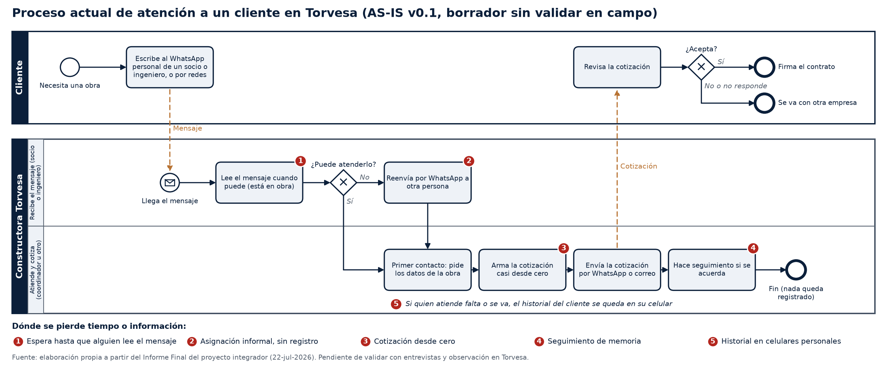

# Proceso actual (AS-IS) de atención a un cliente en Torvesa · v0.1

> [!warning] Borrador sin validar en campo
> Este diagrama sale de lo que ya teníamos escrito: el **Informe Final del proyecto integrador (22-jul-2026)**, que es el antecedente vigente, y el flujo que nombra el Cap. 2. **No se ha observado ni entrevistado a nadie en Torvesa para esta versión.** Se valida cuando la empresa autorice el campo (guía de entrevista I3 y protocolo P2). Para la Revisión 1 se presenta como «modelo preliminar».

## En tres frases (resumen para Víctor, S2-T15)
1. El cliente escribe al **WhatsApp personal** de un socio o ingeniero, que suele estar **en obra** y lee el mensaje cuando puede.
2. Si no puede atender, lo **reenvía por WhatsApp** a otra persona. Esa persona hace el primer contacto y **arma la cotización casi desde cero**.
3. **Nada queda registrado**: el seguimiento depende de la memoria y, si alguien se va, el historial del cliente se queda en su celular.

- **Para editarlo:** abre `2026-10-25_AS-IS_v0.1.bpmn` en https://demo.bpmn.io o en Camunda Modeler. Es BPMN 2.0 estándar, con carriles.
- **Para la presentación:** usa el PNG.

## Los pasos

| # | Quién | Paso | De dónde sale |
|---|---|---|---|
| 1 | Cliente | Escribe al WhatsApp personal de un socio o ingeniero, o por redes sociales | Informe Final, p. 4: las solicitudes «ingresan de manera informal por redes sociales o cuentas personales de WhatsApp». En el censo del informe (n = 5, p. 10), 4 de 5 personas lo confirman (80 %) |
| 2 | Quien recibe | Lee el mensaje cuando puede, porque está en obra | Informe Final, p. 4: el personal reparte su jornada entre oficina y obra. Censo (p. 10): 40 % revisa mensajes cada 3 o 4 horas y 20 % solo al llegar a casa |
| 3 | Quien recibe | ¿Puede atenderlo? Si no, lo reenvía por WhatsApp | Informe Final, p. 7: el contacto se delega «mediante canales informales e individuales». **Supuesto:** el reenvío por WhatsApp como mecanismo concreto |
| 4 | Quien atiende | Primer contacto: pide los datos de la obra | Informe Final, p. 4: las solicitudes quedan «desatendidas durante horas o días» |
| 5 | Quien atiende | Arma la cotización casi desde cero | Resumen del problema (18-oct): las cotizaciones anteriores están dispersas en celulares, WhatsApp y cuadernos |
| 6 | Quien atiende | Envía la cotización por WhatsApp o correo | **Supuesto**, por confirmar en la entrevista |
| 7 | Quien atiende | Hace el seguimiento si se acuerda | Informe Final, p. 7: la gerencia no sabe cuántas cotizaciones hay en curso ni en qué estado están |
| 8 | Cliente | Acepta, o se va con otra empresa sin que quede registrado el motivo | Informe Final, p. 4: los clientes se van con competidores que responden más rápido |

## Dónde se pierde tiempo o información

| Punto | Qué pasa | Qué meta lo mide | Qué parte del sistema lo ataca |
|---|---|---|---|
| ❶ Espera | Nadie ve el mensaje hasta que alguien revisa el celular | M1 (respuesta en menos de 15 min) y M3 (clientes perdidos antes del primer contacto) | Aviso inmediato al celular |
| ❷ Asignación informal | El reenvío no deja rastro y no hay un responsable claro | M1 y M3 | Asignación con responsable y registro |
| ❸ Cotización desde cero | Hay que buscar cotizaciones viejas en varios lugares | M2 (tiempo por cotización con IA) | Bóveda más asistente con RAG (borrador) |
| ❹ Seguimiento de memoria | Sin recordatorios, el cliente «se enfría» | Ninguna meta lo mide directamente (M3 solo cuenta hasta el primer contacto). **Duda para Víctor** | Recordatorios y tablero de pendientes |
| ❺ Historial en celulares | Si alguien se va, se pierde lo que sabía del cliente (A8) | M4 (encontrar el historial de un cliente ajeno) | Bóveda con el historial de cada cliente |

Los códigos de las metas (M1–M4) son los del Glosario. El censo de n = 5 es del Informe Final y se vuelve a confirmar en campo.

## Cómo se hizo (para el Cap. 3)
- **Notación:** BPMN 2.0 de la OMG, con un carril por rol. Es el estándar pensado para que lo entiendan las personas del negocio (Object Management Group, 2013, p. 1). Los carriles por rol son lo que mejor entienden los empleados de una empresa mediana (Nizioł et al., 2021, p. 199).
- **Método:** primero se arma un borrador con los documentos que ya existen y después se valida con entrevistas y observación, como en Zambrano Loor y García Vera (2025, p. 79) y en Martínez Mendoza et al. (2023, p. 4836). Esta última trabajó con una empresa que no llevaba registros, que es el caso probable de Torvesa.

## Qué hay que validar en campo (preguntas para la entrevista I3)
1. ¿Por dónde llegan las solicitudes? ¿Qué parte llega por WhatsApp personal, por redes, por teléfono o en persona?
2. ¿Quién decide quién atiende a un cliente nuevo? ¿Siempre la misma persona?
3. ¿Hay visita a la obra antes de cotizar? Si la hay, falta un paso entre el 4 y el 5.
4. ¿Quién arma la cotización y con qué herramienta (Excel, Word, plantilla)? ¿De dónde saca los precios?
5. ¿Alguien aprueba la cotización antes de enviarla (gerencia)? Si es así, falta una compuerta.
6. ¿Cómo se envía la cotización y cómo se hace el seguimiento?
7. Cuando un cliente se pierde, ¿alguien lo anota?

## Lo que no es este documento
- No es el proceso con el sistema (TO-BE). Ese es del sprint 4 (2–4 nov).
- No trae datos de clientes reales. Los ejemplos de la bóveda usan `CLI-0001`.
