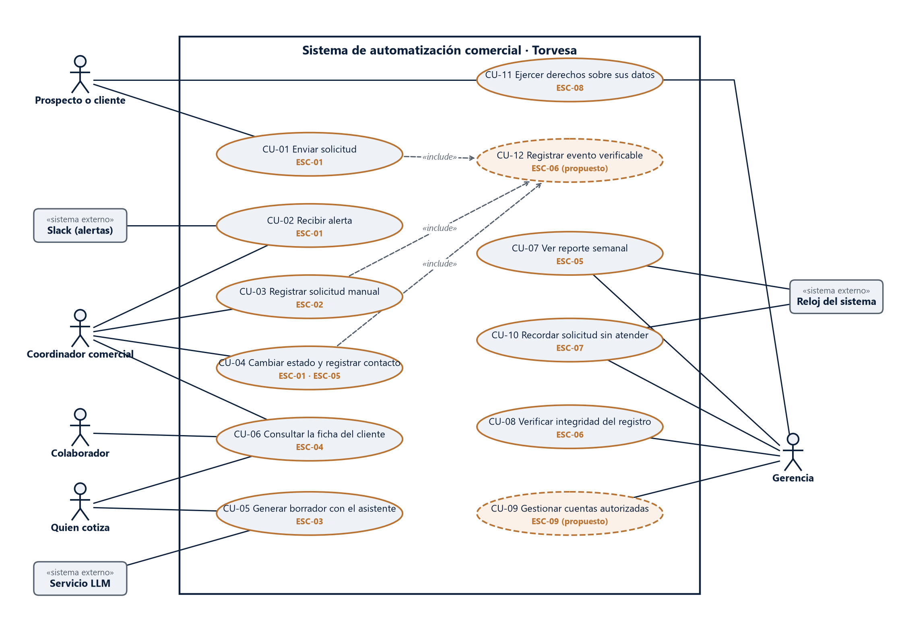
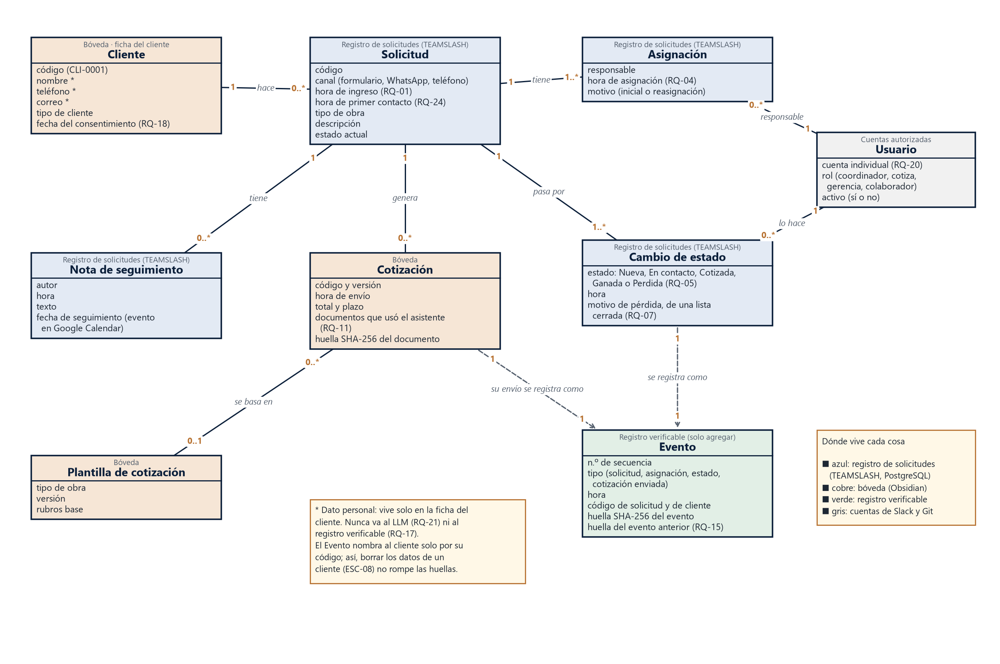

# Casos de uso y modelo conceptual · v0.1

> [!info] Cómo editarlos
> Los `.drawio` se abren en https://app.diagrams.net (Archivo → Abrir desde → Dispositivo) o con la extensión «Draw.io Integration» de VS Code. El PNG es para el Word y la presentación. Si se cambia el `.drawio`, hay que volver a exportar el PNG (Archivo → Exportar como → PNG).
>
> La fecha del nombre (31-oct) es la que fija el cronograma para el bloque M; el trabajo se hizo el 2-nov.

## 1. Diagrama de casos de uso

Un **caso de uso** es algo que una persona (o un sistema externo) hace con el sistema para lograr un objetivo. Las elipses son los casos de uso; los muñecos, las personas; las cajas grises, los sistemas externos. La flecha punteada «include» indica que un caso **siempre** incluye a otro.

| Caso de uso | Actores | Escenario | Requerimientos |
|---|---|---|---|
| CU-01 Enviar solicitud | Prospecto o cliente | ESC-01 | RQ-01, RQ-18 |
| CU-02 Recibir alerta | Coordinador comercial, Slack | ESC-01 | RQ-02 |
| CU-03 Registrar solicitud manual | Coordinador comercial | ESC-02 | RQ-03 |
| CU-04 Cambiar estado y registrar contacto | Coordinador comercial | ESC-01, ESC-05 | RQ-04, RQ-05, RQ-07, RQ-24 |
| CU-05 Generar borrador con el asistente | Quien cotiza, servicio LLM | ESC-03 | RQ-10, RQ-11, RQ-12, RQ-21 |
| CU-06 Consultar la ficha del cliente | Coordinador, quien cotiza, colaborador | ESC-04 | RQ-09, RQ-13, RQ-14 |
| CU-07 Ver reporte semanal | Gerencia, reloj del sistema | ESC-05 | RQ-08 |
| CU-08 Verificar integridad del registro | Gerencia | ESC-06 | RQ-16 |
| CU-09 Gestionar cuentas autorizadas | Gerencia | **ESC-09 (propuesto)** | RQ-20 |
| CU-10 Recordar solicitud sin atender | Gerencia, reloj del sistema | ESC-07 | RQ-06 |
| CU-11 Ejercer derechos sobre sus datos | Prospecto o cliente, gerencia | ESC-08 | RQ-19 |
| **CU-12 Registrar evento verificable (propuesto)** | — (lo incluyen CU-01, CU-03 y CU-04) | ESC-06 | RQ-15, RQ-17 |

**Comprobación del bloque:** todos los casos de uso tienen escenario. Dos necesitan algo que el documento todavía no tiene (abajo).

### Cambios frente a la sección 8.5 de la elicitación (para que Víctor decida)
1. **CU-12 nuevo, Registrar evento verificable.** RQ-15 no tenía caso de uso. Se dibuja como «include» de los casos que cambian algo: enviar, registrar y cambiar estado. El envío de una cotización también genera un evento; se ve en el modelo conceptual.
2. **ESC-09 nuevo (propuesto), Alta y baja de un vendedor.** CU-09 no tenía escenario. Propuesta: *«Entra o sale un vendedor → la gerencia crea o desactiva su cuenta → sus solicitudes abiertas se reasignan → la cuenta queda registrada con fecha»*. Sirve también para ESC-04, porque las fichas del que se fue siguen en la bóveda.
3. **Colaborador como actor de CU-06.** En la sección 8.5 no aparecía, pero ESC-04 es suyo (INT-04).
4. **CU-04 ahora registra también el primer contacto** (RQ-24, propuesto en la revisión del 2-nov).
5. **Slack:** se dibuja solo en CU-02. El recordatorio de CU-10 sale por el mismo canal, pero se omitió la línea para que el diagrama se pueda leer.

## 2. Modelo conceptual del dominio

El **modelo conceptual** muestra las «cosas» que el sistema tiene que recordar y cómo se relacionan. No es todavía la base de datos: no lleva tipos de dato ni tablas, eso es del modelo de datos del sprint 8 (S8-02). Los números en los extremos de cada línea dicen **cuántos**. Por ejemplo, «Cliente 1 — 0..* Solicitud» quiere decir que un cliente puede tener ninguna o muchas solicitudes, y cada solicitud es de un solo cliente.

**Decisiones de diseño que se ven en el modelo:**
- **Los datos personales viven en un solo lugar:** la ficha del cliente (marcados con \*). El Evento nombra al cliente solo por su código. Así se cumple RQ-17, y se puede borrar a un cliente (ESC-08) sin romper la cadena de huellas.
- **Asignación y Cambio de estado son registros aparte de la Solicitud.** El MVP de TEAMSLASH guarda solo el estado actual; para medir M1 y para RQ-05 hace falta el historial.
- **«Hora de primer contacto» es un dato propio de la Solicitud** (RQ-24): de ahí sale M1.
- **La Cotización guarda la huella SHA-256 del documento enviado** (ESC-06) y qué documentos usó el asistente (RQ-11).
- **Colores = dónde vive cada cosa:**
  - azul: registro de solicitudes (TEAMSLASH, PostgreSQL);
  - cobre: bóveda (Obsidian);
  - verde: registro verificable;
  - gris: cuentas de Slack y Git.

  Es una propuesta: se confirma al diseñar la bóveda (sprint 4).

**Qué falta y de dónde sale:**
- el catálogo de tipos de obra y la plantilla de cotización (PEN-12, taller);
- la lista cerrada de motivos de pérdida (PEN-07, taller);
- si alguien aprueba la cotización antes de enviarla (PEN-08). Si es así, al modelo le falta una «Aprobación».
