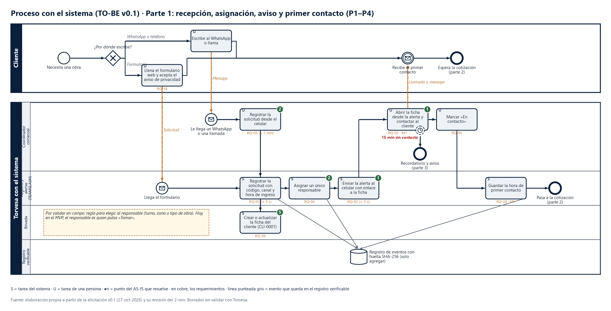

# TO-BE parte 1 · Recepción, asignación, aviso y primer contacto

Para editarlo, abre el `.bpmn` en https://demo.bpmn.io o en Camunda Modeler. El PNG sale del mismo dibujo.

## Los pasos

| # | Paso | Tarea | Carril (responsable) | Disparador | Entra | Sale | Evento que se registra | Requerimientos | Meta | Resuelve |
|---|---|---|---|---|---|---|---|---|---|---|
| 1 | P1 | Llenar el formulario web y aceptar el aviso de privacidad | Cliente | Necesita una obra | Datos de la obra | Solicitud con consentimiento | — | RQ-18 | — | — |
| 2 | P1 | Registrar la solicitud desde el celular | Coordinador comercial | Le llega un WhatsApp o una llamada | Mensaje del cliente | Solicitud con hora real de llegada | — | RQ-03 | M1, M3 | ❷ |
| 3 | P1 | Registrar la solicitud con código, canal y hora de ingreso | Registro y alertas | Llega el formulario o el registro manual | Solicitud | Solicitud registrada | Solicitud | RQ-01 | M1 | ❷ |
| 4 | P1 | Crear o actualizar la ficha del cliente | Bóveda | Solicitud registrada | Código del cliente | Ficha CLI-0001 | — | RQ-09 | M4 | ❺ |
| 5 | P2 | Asignar un único responsable | Registro y alertas | Ficha lista | Solicitud | Responsable con hora | Asignación | RQ-04 | M1 | ❷ |
| 6 | P3 | Enviar la alerta al celular con enlace a la ficha | Registro y alertas | Responsable asignado | Solicitud y responsable | Alerta en ≤ 5 s | — | RQ-02 | M1 | ❶ |
| 7 | P4 | Abrir la ficha desde la alerta y contactar al cliente | Coordinador comercial | Llega la alerta | Ficha | Llamada o mensaje al cliente | — | RQ-02 | M1 | ❶ |
| 8 | P4 | Marcar «En contacto» | Coordinador comercial | Hizo el contacto | Solicitud | Estado «En contacto» | Cambio de estado | RQ-05 | M1 | ❷ |
| 9 | P4 | Guardar la hora de primer contacto | Registro y alertas | Cambio a «En contacto» | Solicitud | Hora de primer contacto | Primer contacto | RQ-24 | M1 | ❶ |

## Compuertas y excepciones

| Compuerta o excepción | Qué pasa | Escenario |
|---|---|---|
| ¿Por dónde escribe el cliente? | Formulario → registro automático. WhatsApp o teléfono → el coordinador lo registra (≤ 1 min) o le manda el enlace al formulario | ESC-01, ESC-02 |
| 15 min sin primer contacto (temporizador que no interrumpe la tarea) | Sigue en la parte 3: recordatorio al responsable y aviso a la gerencia | ESC-07 |
| El coordinador está sin señal | La alerta llega al recuperar la conexión; el temporizador sigue corriendo | ESC-01 |

## Qué se valida en el taller
- La regla para elegir al responsable: turno, zona o tipo de obra. Hoy, en el MVP, el responsable es quien pulsa «Tomar».
- Si el aviso a la gerencia a los 15 min se acepta (CON-06).

## Supuestos
- El coordinador tiene el celular con datos móviles y la app de alertas (Slack) instalada.
- Las solicitudes por WhatsApp se registran a mano. Si no se registran, no se miden (RIE-03).
- **El MVP hay que volver a desplegarlo:** al 2-nov no responde en Railway (RIE-07).
