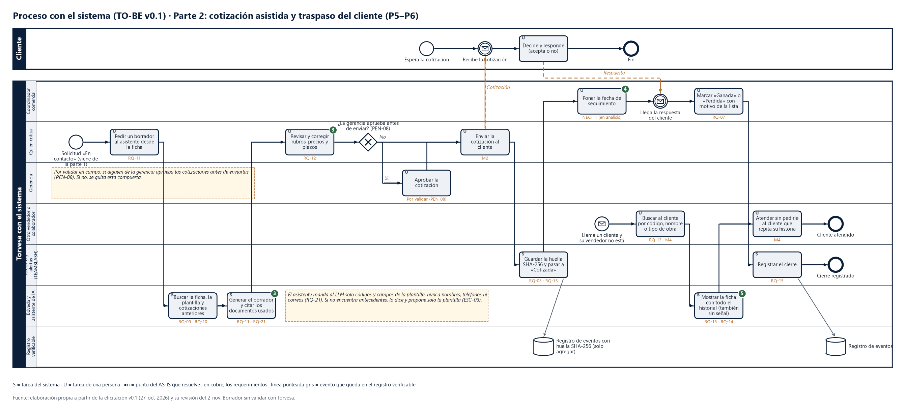

# TO-BE parte 2 · Cotización asistida y traspaso del cliente

## Los pasos

| # | Paso | Tarea | Carril (responsable) | Disparador | Entra | Sale | Evento que se registra | Requerimientos | Meta | Resuelve |
|---|---|---|---|---|---|---|---|---|---|---|
| 1 | P5 | Pedir un borrador al asistente desde la ficha | Quien cotiza | Solicitud «En contacto» (parte 1) | Ficha y datos de la obra | Pedido de borrador | — | RQ-11 | M2 | ❸ |
| 2 | P5 | Buscar la ficha, la plantilla y cotizaciones anteriores | Bóveda y asistente | Pedido de borrador | Código del cliente y tipo de obra | Documentos de referencia | — | RQ-09, RQ-10 | M2 | ❸ |
| 3 | P5 | Generar el borrador y citar los documentos usados | Bóveda y asistente | Documentos encontrados | Solo códigos y campos de la plantilla | Borrador con citas | — | RQ-11, RQ-21 | M2 | ❸ |
| 4 | P5 | Revisar y corregir rubros, precios y plazos | Quien cotiza | Borrador listo | Borrador | Cotización revisada | — | RQ-12 | M2 | ❸ |
| 5 | P5 | Aprobar la cotización (solo si la gerencia aprueba antes) | Gerencia | Cotización revisada | Cotización | Cotización aprobada | — | PEN-08 | — | — |
| 6 | P5 | Enviar la cotización al cliente | Quien cotiza | Cotización revisada o aprobada | Cotización | Cotización enviada | — | RQ-12 | M2 | — |
| 7 | P5 | Guardar la huella SHA-256 y pasar a «Cotizada» | Registro y alertas | Cotización enviada | Documento enviado | Huella y estado | Cotización enviada | RQ-05, RQ-15 | M5 | — |
| 8 | P5 | Poner la fecha de seguimiento | Coordinador comercial | Estado «Cotizada» | Solicitud | Fecha (evento en Google Calendar) | — | NEC-11 | — | ❹ |
| 9 | P5 | Marcar «Ganada» o «Perdida» con motivo de la lista | Coordinador comercial | Llega la respuesta del cliente | Respuesta | Estado final y motivo | Cierre | RQ-05, RQ-07 | M3 | — |
| 10 | P6 | Buscar al cliente por código, nombre o tipo de obra | Otro vendedor o colaborador | Llama un cliente y su vendedor no está | Dato del cliente | Ficha encontrada | — | RQ-13 | M4 | ❺ |
| 11 | P6 | Mostrar la ficha con todo el historial, también sin señal | Bóveda | Búsqueda | Código | Historial completo | — | RQ-13, RQ-14 | M4 | ❺ |
| 12 | P6 | Atender sin pedirle al cliente que repita su historia | Otro vendedor o colaborador | Ficha abierta | Historial | Cliente atendido | — | — | M4 | ❺ |

## Compuertas y excepciones

| Compuerta o excepción | Qué pasa | Escenario |
|---|---|---|
| ¿La gerencia aprueba antes de enviar? | Sí → la gerencia aprueba y después se envía. No → se envía directo. **Por validar (PEN-08)**: si nadie aprueba, se quita la compuerta | ESC-03 |
| El asistente no encuentra antecedentes | Lo dice y propone solo la plantilla | ESC-03 |
| El cliente no responde | Lo cubre el seguimiento de la parte 3 | — |
| El vendedor titular se fue de la empresa | Igual que P6; además sus solicitudes se reasignan (parte 3) | ESC-04, ESC-09 |

## Qué se valida en el taller
- Si alguien aprueba las cotizaciones (PEN-08) y si hay visita a la obra antes de cotizar (PEN-09). Si hay visita, falta un paso entre P4 y P5.
- El catálogo de tipos de obra para las plantillas (PEN-12).
- La lista cerrada de motivos de pérdida (PEN-07).
- Si el seguimiento (NEC-11) entra: el MVP ya crea el evento en Google Calendar.

## Supuestos
- Quien cotiza trabaja en la oficina, con computadora (sección 8.2 de la elicitación).
- El envío al cliente lo hace una persona; el sistema nunca envía solo (RQ-12).
