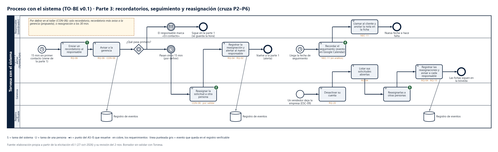

# TO-BE parte 3 · Recordatorios, seguimiento y reasignación

Son tres flujos cortos que arrancan solos, por tiempo o por un hecho, y cruzan los pasos de las partes 1 y 2.

## Los pasos

| # | Flujo | Tarea | Carril (responsable) | Disparador | Sale | Evento que se registra | Requerimientos | Meta | Resuelve |
|---|---|---|---|---|---|---|---|---|---|
| 1 | A · Sin atender | Enviar un recordatorio al responsable | Registro y alertas | 15 min sin primer contacto | Recordatorio | — | RQ-06 | M1, M3 | ❶ |
| 2 | A | Avisar a la gerencia | Registro y alertas | Recordatorio enviado | Aviso | Aviso a la gerencia | RQ-06, CON-06 | M3 | ❷ |
| 3 | A | ¿Qué pasa primero? | Registro y alertas | — | El responsable marca «En contacto» → vuelve a la parte 1. Pasan otros 15 min → reasignación | — | — | — | — |
| 4 | A | Reasignar la solicitud a otra persona | Gerencia | Otros 15 min sin contacto | Nuevo responsable | — | CON-06 (por validar) | M1 | ❷ |
| 5 | A | Registrar la reasignación y alertar al nuevo responsable | Registro y alertas | Reasignación | Alerta | Asignación | RQ-04, RQ-02 | M1 | ❷ |
| 6 | B · Seguimiento | Recordar el seguimiento (evento en Google Calendar) | Registro y alertas | Llega la fecha de seguimiento | Recordatorio | — | NEC-11 (en análisis) | — | ❹ |
| 7 | B | Llamar al cliente y anotar la nota en la ficha | Responsable | Recordatorio | Nota y, si hace falta, nueva fecha | — | NEC-11 | — | ❹ |
| 8 | C · Baja de un vendedor | Desactivar su cuenta | Gerencia | Un vendedor deja la empresa | Cuenta inactiva | — | RQ-20 | — | ❺ |
| 9 | C | Listar sus solicitudes abiertas | Registro y alertas | Cuenta desactivada | Lista | — | RQ-04 | — | ❺ |
| 10 | C | Reasignarlas a otras personas | Gerencia | Lista | Nuevos responsables | — | RQ-04 | M4 | ❺ |
| 11 | C | Registrar las reasignaciones y avisar a cada responsable | Registro y alertas | Reasignación | Alertas | Asignación | RQ-04, RQ-15 | M4 | ❺ |

El flujo C es el **ESC-09 propuesto** (alta y baja de un vendedor). Las fichas del que se fue se quedan en la bóveda: así se cumple M4.

## Qué se valida en el taller
- **CON-06**, qué pasa a los 15 min. Hay tres opciones:
  - (a) solo recordatorio;
  - (b) recordatorio y aviso a la gerencia: es la propuesta y es lo que está dibujado;
  - (c) además, reasignación a los 30 min.

  El segundo plazo de 15 min es un supuesto.
- Si el seguimiento después de cotizar (NEC-11) entra en la validación.

## Supuestos
- La gerencia puede reasignar desde el celular.
- Los recordatorios salen por el mismo canal que las alertas (Slack).

## Lo que no está en el TO-BE (no son pasos del flujo de atención)
Estos procesos son de la gerencia y ya tienen caso de uso. Si Víctor lo pide, se dibujan como parte 4:
- el reporte semanal (RQ-08, CU-07);
- la verificación de integridad (RQ-16, CU-08);
- la eliminación de datos a pedido del cliente o al vencer el plazo (RQ-19, CU-11).
